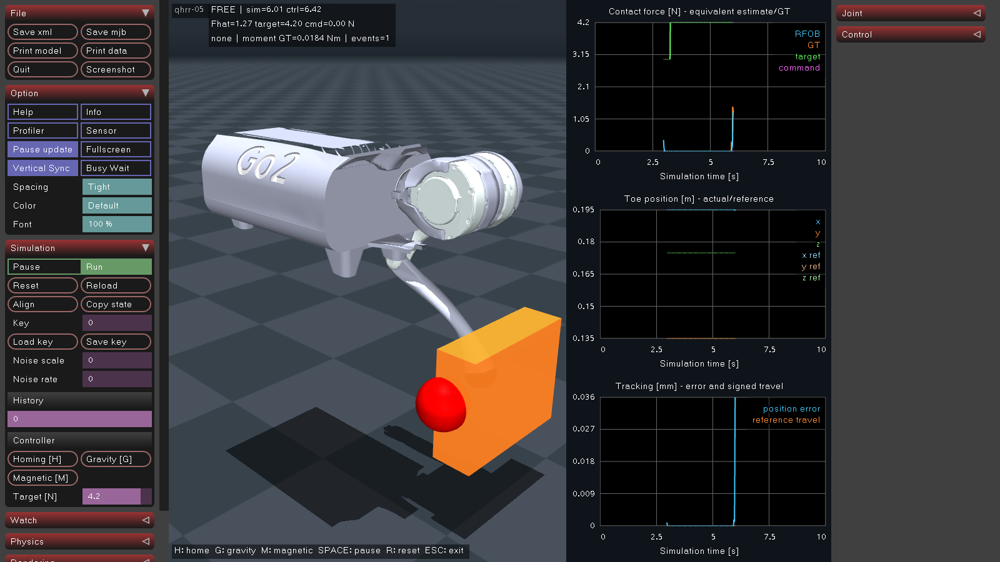

# qhrr-05 제어 검증

고정 베이스 3자유도 다리(HR / HP / KP)의 호밍·중력보상·Magnetic Touch를 검증하는 C++ 프로그램입니다. 모델은 Go2 몸통과 FL 다리만 사용합니다.

기본 제어 경로는 **TaskController → SHM → CAN HAL → vcan → MuJoCo 가상 모터**입니다. 모터는 수신한 MIT 위치·속도 목표와 kp/kd로 내부 PD를 계산합니다. 관절 위치·속도·Iq는 CAN 응답으로 돌아오며 제어기는 이를 사용합니다. tau_ff는 사용하지 않습니다. 기존 SHM 토크 구동은 `--without-can` 디버깅 모드에만 남겼습니다.

## 빌드와 실행

Linux, CMake 3.22 이상, C++17 컴파일러(DataTamer 내부 빌드는 C++20), pkg-config, yaml-cpp, GLFW/OpenGL, OpenSSL·zstd·lz4 개발 라이브러리가 필요합니다. MuJoCo는 `third_party/mujoco`의 헤더·라이브러리를 사용합니다. GUI 실행에는 디스플레이가 필요합니다.

저장소 루트에서 실행합니다.

```bash
cmake -S . -B build -DCMAKE_BUILD_TYPE=Debug
cmake --build build --parallel 2
./scripts/run_daemon.sh
```

daemon은 [프로세스 목록](config/daemon/daemon.yaml)에 따라 **CAN HAL·시뮬레이터·TaskController·shm_logger를 직접 자식으로 실행**하고 종료·자식 회수를 관리합니다. 각 프로그램의 출력과 기본 프로세스 통계를 별도 GNOME 터미널에 표시하며, CAN 창에는 채널 점유율 바도 표시합니다. 창에서는 동일 실행 파일의 출력 전용 함수만 실행하고, 프로세스 수명 관리는 원래 daemon 하나가 담당합니다. 핵심 프로세스의 Ctrl+C·터미널/시뮬레이터 종료 시 나머지도 정리합니다. 선택적 로거의 종료·창 닫기는 로거만 재시작하며 제어를 중단하지 않습니다.

기본 런처는 **호스트 네트워크에 vcan0를 생성하고 UP으로 올린 뒤** daemon을 실행합니다. 이미 UP인 vcan은 재사용하고, DOWN이면 활성화합니다. 같은 이름의 다른 종류 장치는 변경하지 않고 실패합니다. 최초 생성·활성화에 권한이 필요하면 해당 `ip link` 명령에만 sudo를 사용하며 daemon·GUI·제어기는 현재 사용자로 실행합니다. vcan 준비나 HAL 시작 실패를 디버깅 경로로 대체하지 않습니다.

| 실행 | 구성 |
| --- | --- |
| `./scripts/run_daemon.sh` | 기본: 호스트 vcan0 생성·활성화 + 전체 프로그램 |
| `./scripts/run_daemon.sh --isolated-vcan` | 디버깅 전용: 격리 네임스페이스에 vcan0 생성 |
| `./scripts/run_daemon.sh --existing-can` | 이미 준비된 호스트 CAN 사용. 인터페이스는 HAL YAML에서 지정 |
| `./scripts/run_daemon.sh --without-can` | 디버깅 전용: CAN 준비와 HAL을 생략하고 `debug_processes` 실행 |
| 위 명령에 `--no-terminals` 추가 | 명시적 헤드리스 진단: 별도 터미널을 생략하고 자식 출력을 현재 스트림에 연결 |

호스트 vcan0는 daemon 종료 후에도 남습니다. 일반 터미널에서 `ip -details -statistics link show vcan0`로 확인할 수 있습니다. 최초 sudo 인증은 터미널에서 진행합니다. 권한이 없으면 오류로 중단하며 호스트 인터페이스가 없는 채 실행하지 않습니다.

호스트 CAN이 준비되어 있으면 `./build/daemon`을 직접 실행할 수도 있습니다. CAN 없는 디버깅은 `./build/daemon --without-can`으로도 선택합니다. 선택한 모드는 로그에 표시합니다.

프로그램별 옵션은 목록의 `args`에 지정합니다. 다른 목록은 `./build/daemon --config FILE.yaml`로 선택합니다. SHM 이름은 최상위 `shm_name`에서 한 번 정하고, `args`의 `"{shm_name}"` 인자에 치환합니다. daemon이 SHM 생성·초기화·해제를 담당하고 CAN HAL은 소켓을 소유합니다.

기본 MCAP 기록과 5초 이전/2초 이후 Flight Recorder는 daemon이 실행합니다. [로깅 설정·CLI·분석 안내](docs/logging.md)에서 저장 한계·기록 제어·검증 범위를 확인할 수 있습니다. 별도 CSV 진단이 필요하면 명시적으로 실행합니다. 기존 CSV는 덮어쓰지 않습니다.

```bash
./build/shm_logger --csv /qhrr05 /tmp/qhrr05-new-run.csv
./build/qhrr-logctl status
./build/qhrr-logctl trigger
```

## 프로세스 터미널과 SHM 통계

기본 실행은 HAL·시뮬레이터·TaskController·로거마다 터미널을 하나씩 엽니다. 추가한 프로세스도 자동으로 별도 창을 받습니다. 창 상단에는 PID·상태·직전 관측 간격의 CPU 사용률·RSS·스레드 수·가동 시간을 **2초마다** 갱신합니다. CPU는 여러 코어를 사용하면 100%를 넘을 수 있습니다. CAN 창에는 기존 모터 상태와 점유율도 같은 고정 영역에 표시합니다.

통계 갱신은 로그 영역을 스크롤하지 않습니다. 실제 stdout/stderr는 하단 로그 영역과 실행별 `logs/run-<epoch_ms>-<daemon_pid>/<process>.log`에 함께 기록합니다. 통계 패널은 이 파일에 섞지 않습니다. 시작 실패 메시지도 기록하며, 정상 종료 시 프로그램을 먼저 종료하고 릴레이가 EOF까지 읽은 뒤 창을 닫습니다. 창 크기가 아직 0이거나 너무 작으면 명시적인 대기/잘림 안내를 표시합니다. 로그는 계속 전달됩니다. 기본 실행은 아래 자동 배치로 충분한 작업 영역을 확보합니다.

화면은 터미널의 별도 화면 버퍼를 사용합니다. 정상 종료·Ctrl+C·오류 종료 시 원래 화면·제목·커서·스크롤 영역을 복원하므로 통계가 셸에 남지 않습니다. 핵심 프로세스 창의 Ctrl+C는 daemon에, 선택적 로거 창의 Ctrl+C는 로거에 전달하며 마지막 종료 로그까지 읽습니다. 화면 크기를 변경하면 최근 메시지 최대 200줄을 다시 배치하고, 전체 로그는 파일에 보존합니다.

설정은 [daemon.yaml](config/daemon/daemon.yaml)에 모았습니다. 경로는 해당 YAML 디렉터리 기준입니다.

```yaml
terminal_exec: /usr/bin/gnome-terminal.real
log_directory: ../../logs
terminal_layout:
  monitor: auto
  columns: 2
  gap_px: 12
  margin_px: 12
  zoom: 0.85
  include_daemon: true
monitoring:
  display_interval_sec: 2.0  # 1초 초과, 최대 60초
  window_sec: 10.0          # 0초 초과, 최대 60초
  sample_hz: 100.0          # 1~1000 Hz; 제어 주기와 무관
```

기본 `terminal_layout`은 **보조 모니터가 있으면 첫 보조 모니터**, 없으면 주 모니터를 선택하며 선택 결과를 `[layout]` 로그에 출력합니다. 운영체제 패널을 제외한 작업 영역에 2열로 배치하고, 마지막 줄에 창 하나만 남으면 그 줄의 전체 폭을 사용합니다. daemon을 일반 GNOME 터미널에서 실행하면 그 창도 포함해 기본 다섯 창을 2열로 정렬합니다. stdout을 파일로 연결하면 실제 호출 창이 없으므로 자식 터미널만 배치합니다.

`monitor`는 `auto`, `primary`, 또는 `xrandr --listmonitors`에 표시되는 이름(예: `DP-2`)입니다. `columns`는 1~8, 여백·간격은 0~200 px, 자식 터미널 `zoom`은 0.5~2.0으로 조정합니다. 기존 호출 터미널의 글꼴 설정은 유지합니다. IDE 내장 터미널처럼 독립된 호출 창을 찾을 수 없는 경우에는 `include_daemon: false`를 명시합니다. 배치는 **시작 시에만** 적용하므로 이후 사용자가 창을 자유롭게 옮길 수 있습니다.

이 기능은 **GNOME/X11 + XRandR** 기준입니다. 고정 문자 수만 요청하지 않고 실제 창 장식·문자 셀 크기를 반영해 위치와 크기를 검증합니다. 창 식별에는 실행별 고유 `WM_WINDOW_ROLE`을 사용해 같은 제목의 다른 창을 이동하지 않습니다. 지정 모니터 없음·지원하지 않는 창 관리자·배치 거부·읽기 어려운 작은 타일(최소 600×360 px)은 오류로 알리며 겹친 창이나 임의의 다른 배치로 대체하지 않습니다. 창 관리자가 없는 시험용 X11은 작업 영역 정보가 없음을 알리고 모니터 경계를 사용합니다. native Wayland 창의 위치 제어는 지원하지 않습니다.

`terminal_title`과 프로그램별 `terminal_exec`은 필요할 때만 덮어씁니다. 터미널을 사용할 수 없으면 실행을 실패로 보고하며 `--no-terminals`로 자동 전환하지 않습니다. 이 옵션을 직접 지정하면 로그 파일/개별 창 대신 현재 stdout/stderr를 사용하고, daemon의 SHM 표는 계속 출력합니다.

Daemon은 기존 SHM 필드만 읽습니다. mutex는 trylock으로 시도하고 사용 중이면 표본을 건너뛰어 `busy skips`에 표시합니다. 통계 계산·화면 출력·파일 쓰기는 잠금 밖에서 수행합니다. SHM 레이아웃과 제어 루프 계측은 추가하지 않았습니다. 이 관측도 짧은 mutex 획득과 CPU 비용은 발생시킵니다.

| 표시 | 계산 및 해석 |
| --- | --- |
| `Age us / command, feedback, model, simulation` | daemon 관측 시각 − 각 발행 시각. feedback은 HAL 발행 Age이며 실제 모터 수신 Age와 구분합니다. CAN 없는 모드에서는 시뮬레이터가 직접 발행한 피드백입니다. |
| `RX worst age us` | 세 모터 `received_ns` 중 가장 오래된 수신 시각의 Age. 세 축 모두 수신 이력이 있어야 표시합니다. |
| `Obs skips #` | 이전 daemon 관측 이후 증가한 시퀀스 − 1. **관측기가 못 본 발행 수**이며 소비자 손실·CAN 패킷 유실이 아닙니다. |
| `Cmd unconsumed distance #` | 최신 `command_sequence` − HAL의 `consumed_command_sequence`. 최신값 방식의 시퀀스 거리이며 큐 깊이가 아닙니다. CAN 없는 모드에서는 `N/A`입니다. |
| `Pub mean us` | 관측 사이 발행 시각 차이 ÷ 해당 발행 시퀀스 증가량. 다중 작성자의 루트 `motor_sequence`와 명령/피드백 시각을 잘못 짝짓지 않습니다. |
| `Model->control lag us` | `control.published_ns` − `input_model_published_ns`. 입력 모델의 오래됨·제어 계산·스케줄링이 포함되므로 IPC 비용으로 해석하지 않습니다. |

각 행의 최소·최대·평균·sigma는 모두 **현재 시간 윈도우 안의 관측 표본** 기준입니다. sigma는 모집단 표준편차이며, 발행 간격 행에서도 **관측 구간 평균 간격들의 변동**만 나타냅니다. 100 Hz 관측으로 500 Hz의 모든 발행 간격과 실제 주기 지터를 복원할 수 없습니다. 빈 윈도우·아직 발행/수신되지 않은 값은 `N/A`입니다. 관측 횟수·mutex 사용 중 건너뜀·역행한 카운터/시각·잘못된 시각의 개수는 실행 누계입니다. Age로 제어 정지나 응답 지연 판정을 내리지 않습니다.

표는 데이터 Age·발행/입력·시퀀스 거리로 나누고, 각 행에 최신값과 시간 윈도우를 10구간으로 나눈 추세를 표시합니다. 추세 높이는 해당 행의 최소~최대 범위에 맞춘 상대값이며 경고 임계값을 뜻하지 않습니다. 터미널에서는 상태와 구역 제목에 색상을 사용하고, 파일로 출력하면 색상 코드를 넣지 않습니다.

다음 항목은 기존 데이터로 알 수 없어 수치에 넣지 않았습니다.

| 제외한 값 | 정확히 측정하려면 필요한 변경 — 이번에는 미구현 |
| --- | --- |
| Mutex Wait Time | 각 `shm_utils::Lock`의 잠금 요청 직전·획득 직후 시각을 기록해야 합니다. daemon 자신의 trylock 건너뜀으로 다른 프로세스의 대기 시간을 추정할 수 없습니다. |
| Mutex Hold Time | 획득 직후~unlock 직전 구간을 계측해야 합니다. 조건변수 대기는 mutex를 놓으므로 hold 구간에서 제외하고 재획득 후 새 구간으로 처리해야 합니다. |
| IPC Overhead | 작성자의 copy/publish/unlock 비용과 소비자의 lock/read/copy 비용을 각각 계측해야 합니다. 전달 지연을 따로 구하려면 동일 시퀀스의 발행 완료·수신 완료 시각도 연결해야 합니다. 현재 타임스탬프 차이는 순수 IPC 비용이 아닙니다. |
| 발행별 실제 지터·소비자별 누락 수 | 작성자/소비자에서 모든 발행·읽기 이벤트를 계측하고, 로컬 집계값이나 별도 trace ring으로 내보내야 합니다. 최신값 두 슬롯만으로 중간 이벤트를 복원할 수 없습니다. |

## GUI 조작

| 입력 | 동작 |
| --- | --- |
| H | 5차 보간 호밍 후 순수 PD 자세 유지 |
| G | 중력보상. 자세 강성·감쇠는 설정값 사용 |
| M | Magnetic Touch: FREE → 접촉 후보 → 힘 추종 → 해제 |
| Target [N] | 목표 접촉력 변경. 접촉 상태는 유지 |
| Space | 물리 일시정지·재개. 제어 루프는 계속 동작 |
| R | 물리 초기화와 재호밍 요청 |
| Esc | 종료 |

몸체를 왼쪽 더블클릭하여 선택한 뒤 Ctrl+오른쪽 드래그로 외력을 가합니다. 주황색 물체도 같은 방식으로 선택·이동하며, Ctrl+Shift+오른쪽 드래그는 수평면 이동입니다. Magnetic 모드에서 물체를 발끝에 접촉시키고 천천히 이동하면 자동으로 힘 추종에 진입합니다. 접촉 해제·작업영역·추종 거리 등 설정 한계를 넘으면 FREE로 복귀합니다.

H/G 화면은 관절각과 피드백 측정 토크를 표시합니다. CAN 모드의 토크 그래프는 반환 Iq와 C4 Kt로 환산한 값을 사용하므로 가상 Iq 센서의 오차·노이즈·CAN 양자화가 반영됩니다. 검증용 CSV의 실제 토크(GT)는 물리 출력으로 별도 기록합니다. M 화면은 추정/실제/목표/명령 힘, 발끝 실제·목표 위치, 추종 오차와 전환 사유를 표시합니다.



## 설정과 코드 위치

| 파일·디렉터리 | 역할 |
| --- | --- |
| [control.yaml](config/control/control.yaml) | 제어 주파수, 각 모션의 게인·목표·한계, RFOB, 그래프 주기 |
| [daemon.yaml](config/daemon/daemon.yaml) | SHM 이름·기본 `processes`와 명시적 CAN 없는 `debug_processes` |
| [can_hal.yaml](config/can_hal/can_hal.yaml) | HAL 인터페이스·주기·CAN ID 배치·모터 설정 경로 |
| [simulation.yaml](config/simulation/simulation.yaml) | 시뮬레이션 실제 모터 특성·가상 Iq 센서 ON/OFF·오차 파라미터 |
| [ak10_9_v3.yaml](config/motor/ak10_9_v3.yaml) | 모터 MIT 규약: V_MAX·T_MAX·Kt·감속비·Kd scale |
| [shm_logger.yaml](config/shm_logger/shm_logger.yaml) | 500 Hz MCAP·Flight Recorder·저장 한계·건전성·세션 설정 |
| [apps/](apps/) | daemon·TaskController·CAN HAL·MuJoCo·로거·입력 프로그램의 실행 진입점 |
| [src/ipc/](src/ipc/) | SHM 전체 배치·메모리 매핑/동기화·공유 값 타입 |
| [src/control/](src/control/) | `TaskController`의 제어기 핸들 소유, 입력 → 제어 → 출력 → 주기 대기 |
| [src/motion_controllers/](src/motion_controllers/) | 호밍·중력보상·Magnetic Touch와 외력 관측기 |
| [src/simulation/](src/simulation/) | 물리·모델 IO·가상 Iq 센서·그래프 |
| [src/motor_can_protocol/](src/motor_can_protocol/) | OpenRobot MIT 코덱 |
| [src/daemon/](src/daemon/) | 기존 `Daemon` 프로세스 관리·터미널 릴레이·SHM 통계 |
| [src/input/](src/input/) | 조이스틱 입력 |
| [src/shm_logger/](src/shm_logger/) | SHM 복사·명시적 스키마·MCAP/RAM 이력·세션/저장 정책·관리 소켓 |
| [third_party/mujoco_simulate/](third_party/mujoco_simulate/) | 프로젝트에서 사용하는 MuJoCo GUI 복사본·출처·해시 |
| [tests/](tests/) | 기능·CAN·SHM·프로세스·GUI 회귀 시험 |

프로젝트는 `apps/`에 실행 프로그램별 `main.cpp`, `src/`에 기능별 구현과 헤더를 함께 둡니다. `TaskController` 클래스는 `src/control/control.hpp/.cpp`, 기존 `Daemon` 클래스는 `src/daemon/daemon.hpp/.cpp`로 옮겼습니다. 별도의 제어 런타임 래퍼는 추가하지 않았습니다.

프로젝트 헤더는 `#include "ipc/shared_memory.hpp"`처럼 `src/` 기준 경로를 씁니다. `qhrr05_common` INTERFACE 타깃은 이 검색 경로만 전달합니다. 실제 구현은 `motion_controllers`, `control_core`, `motor_can_protocol`, `simulation_core`, `daemon_core`, `input_core` 등의 라이브러리로 명시적으로 연결합니다.

앱 디렉터리·실행 파일·구현 모듈은 같은 기능 이름을 사용합니다. config 디렉터리에도 같은 이름을 사용하고, 모터 규약은 `config/motor/`에 둡니다.

| 실행 파일 | 진입점 | 구현 | 설정 |
| --- | --- | --- | --- |
| `daemon` | `apps/daemon/main.cpp` | `src/daemon/` | `config/daemon/daemon.yaml` |
| `control` | `apps/control/main.cpp` | `src/control/` | `config/control/control.yaml` |
| `simulation` | `apps/simulation/main.cpp` | `src/simulation/` | `config/simulation/simulation.yaml` |
| `input` | `apps/input/main.cpp` | `src/input/` | CLI의 SHM 이름·장치 경로 |
| `can_hal` | `apps/can_hal/main.cpp` | 진입점 내부 HAL 및 `src/motor_can_protocol/` | `config/can_hal/can_hal.yaml` |
| `shm_logger` | `apps/shm_logger/main.cpp` | `src/shm_logger/` | `config/shm_logger/shm_logger.yaml` |
| `qhrr-logctl` | `apps/logctl/main.cpp` | 관리 소켓 클라이언트 | CLI의 소켓 경로 또는 기본 daemon 설정 |

이전 실행 파일 `task_controller`, `mujoco_simulate`, `aux_reader`는 각각 `control`, `simulation`, `input`으로 변경했습니다. 제어 주파수 YAML 키도 `control.frequency_hz`를 사용합니다. 별도 daemon 설정은 런처와 daemon 모두 `--config FILE.yaml`로 지정합니다.

HAL 설정의 `motor_config: ../motor/ak10_9_v3.yaml`은 **HAL YAML 디렉터리 기준**으로 해석합니다. HAL과 가상 모터는 같은 HAL 설정을 받아 각자 필요한 항목을 읽습니다. 시뮬레이터 인자는 `--hal-config config/can_hal/can_hal.yaml`입니다. 모터 파일에는 인터페이스·SHM·실행 주기·CAN ID 배치를 넣지 않습니다.

TaskController는 각 모션 클래스의 초기화 인자로 YAML **경로**를 넘깁니다. 각 클래스가 자기 항목을 파싱·검증합니다. 설정을 바꾼 뒤 프로그램을 재시작합니다. 관절 배열 순서는 HR(FL hip) / HP(thigh) / KP(calf)입니다. 게인과 목표값은 위 YAML을 기준으로 합니다.

제어 입력은 TaskController의 이름 있는 상태 배열 한 벌로 보관합니다. `ReadInput()`이 같은 SHM 잠금 안에서 각 모델·관절 값을 명시적으로 읽고, 미분용 이전 샘플은 별도로 유지합니다. Magnetic의 `Start()`는 발끝 위치만 받으며 `Compute()`와 RFOB의 `Update()`는 사용하는 배열·측정 번호·주기를 각각 인자로 받습니다. 모션 제어기는 SHM 데이터 구조를 포함하거나 상속하지 않습니다.

Homing은 보간 위치·속도와 자신의 kp/kd를 MIT 목표로 보냅니다. Gravity는 원래 surrogate 위치 목표를, Magnetic은 `q + (tau + kd_motor*dq)/kp_motor`를 보냅니다. 후자의 kd 항은 이미 계산된 감쇠를 모터 PD에서 중복 적용하지 않기 위한 항입니다. Magnetic의 내부 서보 게인은 `magnetic_touch.kp_motor/kd_motor`에서 설정합니다.

두 모드의 동역학 보상항은 각 설정의 `gravity_only`로 따로 선택합니다. 설정 변경 후 데몬을 재시작합니다.

```yaml
gravity_compensation:
  gravity_only: true
magnetic_touch:
  gravity_only: true
```

`true`는 별도 `mjData`에 qpos를 복사하고 qvel을 0으로 둔 뒤 `mj_fwdPosition()`·`mj_fwdVelocity()`로 구한 순수 중력을 사용합니다. `false`는 실제 속도에서 계산한 전체 `qfrc_bias`(중력+코리올리·원심력)를 사용합니다. Gravity의 `alpha`는 선택한 보상항 전체에 적용합니다. 두 설정 모두 물리 마찰·감쇠와 기존 자세·힘 추종 제어 항을 유지합니다. RFOB는 설정과 관계없이 실제 속도에서의 전체 동역학을 사용합니다. 옵션 누락·잘못된 bool 값은 오류로 처리합니다.

가상 엔코더는 시작 자세에서 상대각 0으로 시작합니다. `MotorData.position_offset[i]`은 시뮬레이션 시작 자세로 초기화하고 제어기가 이를 사용합니다. **실기 영점 보정은 아니며 스토퍼 호밍은 미구현**입니다.

## 가상 Iq 센서

[simulation.yaml](config/simulation/simulation.yaml)의 `iq_sensor.enabled: true`로 켭니다. 현재 기본값은 `true`이며 시작 로그에 ENABLED/DISABLED를 표시합니다. 설정을 바꾼 뒤 데몬을 재시작합니다. 기본 daemon은 시뮬레이터에 `--simulation-config` 경로를 전달합니다. CAN 모드에서 이 경로는 필수이며, 직접 토크 디버깅 `--without-can`에는 적용하지 않습니다.

```yaml
iq_sensor:
  enabled: true
  gain: 1.0
  offset_a: 0.0
  noise_std_a: 0.02
  ripple_amplitude_a: 0.01
  bandwidth_hz: 200.0
  quantization_a: 0.005
  current_limit_a: 40.0
```

위 항목을 기존 파일에서 조정합니다. 이득·오프셋·가우시안 노이즈·전기각 리플·1차 저역통과 필터·센서 양자화·측정 범위를 설정할 수 있습니다. `enabled` 외 센서 값은 스칼라 또는 HR/HP/KP 세 값 배열을 받습니다. `random_seed`는 같은 입력 샘플 순서에서 노이즈를 재현합니다. 대역폭·양자화가 0이면 해당 단계만 생략합니다. CAN 자체의 전류 양자화는 항상 적용됩니다.

물리 스텝마다 MuJoCo 실제 actuator torque에서 `iq_true = tau_actual / (gear_actual * Kt_motor_actual)`를 구합니다. 전기각은 `pole_pairs * gear_actual * q_joint + electrical_zero_rad`입니다. 센서 출력은 CAN Iq 필드로 반환하고 HAL이 `tau_measured = Kt_output_C4 * iq_reported_CAN`을 계산합니다. 센서값을 물리 토크에 직접 주입하지 않습니다. 제어기가 이 피드백에 반응하면서 이후 궤적·토크는 달라질 수 있습니다.

`motor` 항목은 시뮬레이션 실제 특성이며 모터 규약 파일의 C4 보고값과 독립적입니다. 기본은 Kt_motor=0.16 Nm/A·감속비=9로 C4의 1.44 Nm/A와 맞췄습니다. Kt 오차도 별도로 시험할 수 있습니다. `pole_pairs: 1`은 시뮬레이션 위상 설정이며 실기 식별값이 아닙니다. 센서를 끄면 기존 `actuator torque / C4 Kt`의 이상적 CAN 피드백으로 복귀합니다.

센서는 CAN 요청 횟수와 독립적으로 물리 시각마다 한 번 샘플링합니다. 동일 시각의 반복 요청·일시정지는 값을 유지하고, 시뮬레이션 시간 리셋은 필터와 난수 상태도 초기화합니다. CAN HAL 터미널·`shm_logger --can`에서 보고 Iq를 확인할 수 있습니다.

## SHM과 주기

공유 영역은 기본 **`/qhrr05` 하나**이며 이름은 daemon 설정의 `shm_name`으로 지정합니다. CAN 사용 여부와 관계없이 daemon이 자식 실행 전에 생성·초기화하고, 모든 자식을 종료한 뒤 해제합니다. HAL·시뮬레이터·제어기·로거는 연결만 하며, 영역이 없으면 명시적으로 실패합니다. 기존 객체는 재사용·삭제하지 않습니다. daemon이 SIGKILL되면 정리할 수 없으므로 남은 객체는 다음 실행에서 충돌로 보고합니다.

[shared_memory.hpp](src/ipc/shared_memory.hpp)에 magic·ABI 버전·버퍼 수·권한·시계·컴파일된 전체 바이트 크기와 `MotorData`·`ModelData`·`ControlData`·`SimulationData`·`ShmData`를 함께 정의합니다. 연결 시 실제 객체 크기와 헤더의 magic·ABI 버전·크기·버퍼 수를 검사하고 불일치하면 동기화 객체를 사용하기 전에 거부합니다. 레이아웃이나 필드 의미를 변경하면 `kShmAbiVersion`을 올리고 모든 프로세스를 함께 재빌드·재시작합니다. [control_types.hpp](src/ipc/control_types.hpp)에는 여러 곳에서 재사용하는 `MitCommand`·`MotorFeedback`·Magnetic 상태/계측만 남깁니다. 두 헤더는 OpenRobot 코덱을 포함하지 않습니다.

| 영역 | 데이터와 작성자 |
| --- | --- |
| `motors` | `MotorData`: 제어기는 command·command_enabled·reference·debug_torque 배열, HAL은 feedback·motor_torque(Nm)·축별 CAN 상태 배열 갱신 |
| `model` | 시뮬레이터가 M/h/J·중력·마찰·발끝 모델 계산값 발행 |
| `control` | GUI의 모드·목표 힘, 제어기의 상태·RFOB 결과, 선택적 조이스틱 입력 |
| `simulation` | 시뮬레이터가 실제 위치·토크·물체·접촉 GT와 접촉/해제 이벤트 발행 |

같은 영역의 작성자는 **mutex 안에서 최신 슬롯을 반대 슬롯으로 복사하고 자기 필드만 갱신한 뒤 발행**합니다. 명령·피드백 sequence와 시각은 별도입니다. robust mutex 소유자 사망은 명시적 오류입니다. 계산·렌더링·파일 쓰기는 잠금 밖에서 수행합니다.

관절 명령·측정값은 `MotorData` 한 곳을 원본으로 사용합니다. `MitCommand`는 position·velocity·kp·kd·tau_ff를 담고 enable 요청은 별도 `command_enabled[i]`에 둡니다. tau_ff는 0만 허용합니다. TaskController는 패킷 인코딩을 호출하지 않으며 프로토콜 범위·양자화 검증은 HAL이 수행합니다. `MotorProfile`과 설정값 복사본은 SHM에 두지 않습니다. HAL이 C4 모터 응답을 설정과 대조하고, 응답의 Kt와 측정 Iq로 `motor_torque[i]`를 계산합니다. 제어기는 이 토크 값을 바로 사용합니다. 그래프는 로컬 표시 샘플을 만들고 로거는 필요한 영역을 한 번의 잠금으로 읽어 CSV 행을 조합합니다.

제어 주파수는 `control.frequency_hz`로 설정합니다. 제어기는 monotonic 시간으로 동작하며 새 측정이나 물리 run/pause를 기다리지 않고 최신 입력을 사용합니다. 물리 간격은 모델의 `timestep`, 그래프·계측 주기는 `plots.sample_hz`의 시뮬레이션 시간 기준입니다. 물리 일시정지 중에도 제어 시간은 진행합니다. 제어 경로는 응답 지연·관측 누락으로 동작을 바꾸지 않습니다. CSV 평가는 **shm_logger**, 읽기 전용 실시간 SHM 관측은 daemon이 담당합니다. 더블버퍼는 모든 중간 프레임의 기록을 보장하지 않습니다.

RFOB는 새 측정에서만 필터를 갱신합니다. 접촉 GT 힘·모멘트와 물체 좌표는 `simulation`에만 있으며 제어 입력으로 사용하지 않습니다. 현재 관측기는 모델 잔차 기반 발끝 등가 외력 추정입니다. `condim=6`의 접촉 모멘트를 3관절 관측으로 힘과 분리할 수 없으며, Momentum Observer는 미구현입니다.

CAN 모드에서는 새 CAN 피드백에서 속도를 차분하고 RFOB를 갱신합니다. 모델 정보는 별도 주기로 발행되므로 최신 엔코더보다 한 주기 늦을 수 있습니다. 물체 이동·접촉·해제 같은 시뮬레이션 이벤트는 SHM으로 직접 전달해도 되는 영역입니다. 수집 주기마다 `contact`·`contact_event_sequence`·`contact_event_time`을 갱신하며 CSV에도 기록합니다. 이 이벤트 때문에 모터 CAN 패킷을 추가하지 않습니다.

## CAN HAL

HAL은 기본 daemon의 필수 프로세스입니다. 통계 창의 `BUS LOAD est.`는 전체 Classic CAN ID를 별도 수신 소켓으로 관측한 점유율 추정치입니다. [HAL 설정](config/can_hal/can_hal.yaml)의 `bus_load_bitrate`는 표시 기준 비트레이트이며 기본값은 1,000,000 bit/s입니다. 인터페이스 속도는 변경하지 않습니다. vcan에서도 같은 기준으로 계산하며 비트 스터핑 최댓값·프레임 오버헤드를 포함합니다. 100%를 넘으면 수치는 유지하고 바만 끝까지 채웁니다.

기본 자동 배치 빌드에는 X11/XRandR 개발 라이브러리(`pkg-config x11 xrandr`)가 필요합니다. 호스트 vcan 준비에는 iproute2·Python 3와 생성/활성화 권한이 필요합니다. 권한이 없으면 sudo 인증을 요청합니다. `--isolated-vcan` 디버깅에는 `unshare`·D-Bus가 추가로 필요합니다. 터미널 실행 파일은 최상위 `terminal_exec`, 창 이름은 프로그램별 `terminal_title`로 지정합니다. 현재 환경은 FD 전달을 지원하는 `/usr/bin/gnome-terminal.real`을 명시했습니다. 실행 파일·인터페이스·창 오류를 다른 경로로 자동 대체하지 않습니다.

명령은 MIT q target·velocity·kp/kd이며 tau_ff는 논리적 0으로 고정합니다. 기본 시뮬레이터가 C4 프로파일 조회·C1 enable·C0 제어/피드백·C2 release에 응답합니다. 시작 시 가상 모터가 늦게 준비되어도 100 HAL 주기마다 프로파일/enable을 재요청합니다. 응답 지연 판정이나 시간 초과 정지는 없습니다. 명령 API·로깅·프로토콜 범위·스토퍼 보정 결정은 [CAN HAL 동작 규약](docs/can_hal.md)에 정리했습니다.

## 검증과 유지 문서

`main`에는 디렉터리 재구성·터미널 개선과 `logger_and_dashboard`의 텔레메트리·로깅 구현을 통합했습니다. 후속 작업은 `main`에서 분기한 `dynamic_control`에서 이어갑니다.

```bash
ctest --test-dir build --output-on-failure
```

CTest에는 격리된 vcan의 코덱 시험과 실제 MuJoCo 가상 모터 폐루프 시험이 있습니다. 후자는 호밍·G/M·물체 접촉/해제·CAN 정지 중 우회 금지·Release를 검사합니다. 실제 AK10-9 하드웨어 검증은 아닙니다. 회귀 시험은 사용자 튜닝과 분리한 [고정 설정](tests/fixtures/control.yaml)을 사용합니다.

GUI 시험도 위 명령에 포함합니다. `simulator_gui`는 H/G/M 조작·목표 힘 변경·일시정지·Ctrl+드래그를, `can_gui`는 CAN 실행·실패·전체 종료·선택적 로거 창 재시작 경로를 묶어 검사합니다. `logging_core/service/daemon`은 MCAP 스키마·5초/2초 덤프·저장 장애·오프라인 분석·독립적 재시작을 검사합니다. `terminal_layout`과 `terminal_statistics`는 창 배치와 화면 복원·로그 보존을 검사합니다. 공통 [GUI 실행 환경](tests/run_gui_test.sh)과 [X11 도우미](tests/gui_test_utils.py)를 사용하며, Xvfb·D-Bus·xdotool·GNOME Terminal이 필요합니다. 시험은 별도 세션과 임시 디렉터리를 사용하며 프로젝트 문서에 스크린샷을 남기지 않습니다.

- [최근 작업과 다음 우선순위](WORK_NOTE.md)
- [MCAP·Flight Recorder·CLI·분석과 검증 범위](docs/logging.md)
- [CAN HAL 패킷·계측·영점 보정](docs/can_hal.md)
- [코드 작성·포맷 규칙](docs/code_style.md)
- [모델 구조·출처·라이선스](models/qhrr-05/README.md)
- [MuJoCo GUI 복사 출처와 변경 범위](third_party/mujoco_simulate/SOURCE.md)
