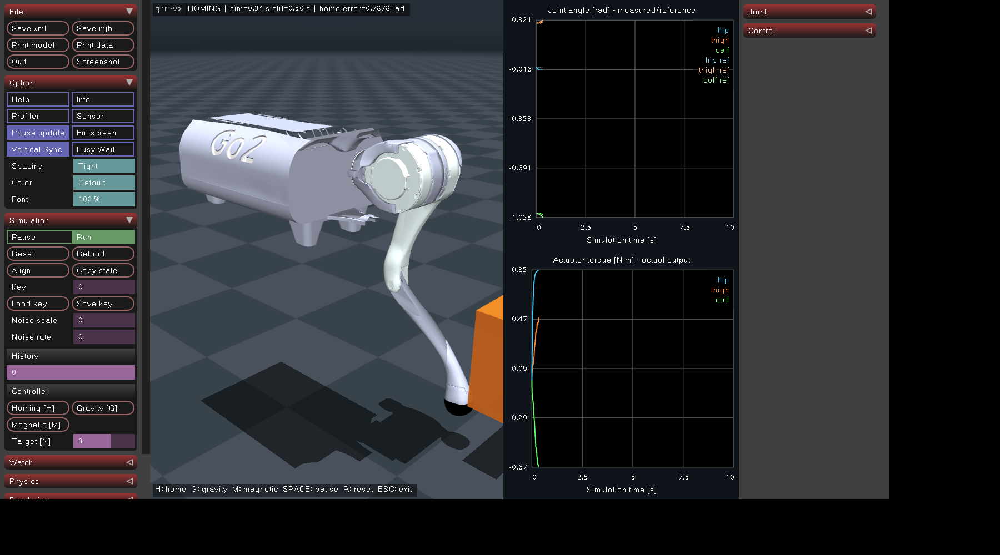

# CAN HAL 핸드오버

2026-10-26 · `zero_gravity` · **CAN HAL 구현 및 기본 daemon 수명 관리 연결**

기본 daemon이 CAN HAL·시뮬레이터·제어기를 직접 자식으로 실행하고 통계 창까지 관리합니다. **실제 제어 데이터의 CAN 연결을 구현했습니다.** TaskController가 MIT 위치 목표를 SHM에 발행하고 HAL이 vcan으로 전송합니다. MuJoCo 가상 모터가 수신 목표로 PD 토크를 계산하고 상대각·속도·Iq를 CAN으로 응답합니다. daemon은 실행·출력 창·수명만 관리합니다. 스토퍼 호밍은 아직 미구현입니다.

전체 빌드·GUI·설정·SHM 구조는 [프로젝트 README](../README.md)를 참고하십시오. 프로토콜 기준은 [OpenRobot v17 명세](https://dongilc.github.io/openrobot-motor-tool/), 모터 기준은 [AK10-9 V3.0 KV60](https://www.cubemars.com/product/ak10-9-v3-0-kv60-robotic-actuator.html)입니다. CubeMars 기본 펌웨어와의 호환을 가정하지 않습니다.

## 실행

기본 런처가 vcan0를 생성·활성화하고 daemon을 통해 전체 프로그램과 통계 창을 실행합니다.

```bash
cmake -S . -B build -DCMAKE_BUILD_TYPE=Debug
cmake --build build --parallel 2
./scripts/run_daemon.sh
```

별도 사용자/네트워크 네임스페이스와 새 D-Bus 세션을 사용합니다. 별도 터미널에는 HAL 출력만 표시합니다. 호스트 인터페이스는 변경하지 않습니다. vcan 준비·HAL 시작 실패 시 전체 실행에 실패하며 디버깅 구성으로 자동 전환하지 않습니다. 기본 시뮬레이터가 가상 모터 상대편이며, 프로파일 확인 후 제어기 목표에 따라 활성화됩니다. 가상 모터가 없으면 WAIT / RELEASED를 유지합니다.

중복 HAL 전용 daemon YAML은 제거했습니다. 실행 구성은 `config/app_config/daemon_config.yaml` 하나로 관리합니다. 기존 호스트 CAN이나 명시적 CAN 없는 디버깅은 다음 중 하나로 선택합니다.

```bash
# 기존 인터페이스는 config/motor_config/can_hal.yaml에 지정
./scripts/run_daemon.sh --existing-can
# CAN 없는 디버깅 전용
./scripts/run_daemon.sh --without-can
```



기본 CAN 1 kHz, 통계 10 Hz, ID 1/2/3, SID 0x141/0x142/0x143입니다. 인터페이스·주기·프로파일·SHM 이름은 HAL YAML에서 읽습니다. `C4`의 V_MAX/T_MAX/Kt_out/gear/Kd scale을 확인하고 일치하는 모터만 enable할 수 있습니다. 응답이 없으면 WAIT를 유지하며 지연으로 자동 종료하지 않습니다.

## q target 입력

공개 SHM 계약은 `include/shared_memory.hpp`의 `motor_targets`/`can_states`입니다. `PositionTarget`에는 **enabled, position, velocity, kp, kd**만 있고 토크·feedforward 입력은 없습니다. q target은 **모터의 출력축 상대 좌표 rad**입니다. 현재 시뮬레이션은 시작 자세를 encoder origin으로 사용하며 TaskController가 같은 초기 자세 offset을 적용합니다. 실제 기구의 런타임 영점은 후속 스토퍼 호밍으로 대체합니다.

Homing은 보간 q/dq와 자체 게인을 보냅니다. G/M은 `q_motor_target = q_joint - offset + (tau + kd_motor*dq)/kp_motor`로 환산합니다. Gravity에서는 기존 surrogate 위치식과 같으며, 그래프용 desired reference를 모터 목표로 잘못 사용하지 않습니다. Magnetic의 내부 PD 게인은 해당 클래스가 YAML의 `kp_motor/kd_motor`를 읽습니다. CAN 모드에서 SHM의 토크 명령은 물리에 적용하지 않습니다.

다음 수동 명령은 TaskController를 실행하지 않는 별도 디버깅 세션에서 사용합니다. 기본 세션의 목표 작성자는 TaskController이므로 수동 명령을 계속 덮어씁니다. 축 번호는 HR=0, HP=1, KP=2입니다.

```bash
./build/can_hal --target /qhrr05_can 0 0.2 0.0 40.0 0.3
./build/can_hal --release /qhrr05_can
```

제어 프로그램은 잠금 안에서 최신 `ShmMotorTargets`를 복사하고 목표를 갱신한 뒤, 새 sequence의 반대 슬롯을 채우고 `motor_target_sequence`를 발행하면 됩니다. HAL은 매 주기 최신 완성된 목표를 송신합니다. 새 목표나 CAN 응답을 기다리며 주기를 멈추지 않습니다.

C1 enable 확인 후 C0 위치 명령을 송신합니다. 아직 검증되지 않은 C4와 미확인 C1은 100 HAL 주기마다 재요청합니다. 응답 경과 시간·데드라인을 평가하지 않습니다. Release 이후에는 C2를 보내고 C0를 중단하므로 이전 목표가 모터를 다시 켜지 않습니다. 종료할 때도 C2를 보냅니다. 범위 밖 목표·잘못된 설정·프로파일 불일치는 명시적 오류이며 프로토콜이나 경로를 대체하지 않습니다.

**tau_ff는 사용하지 않습니다.** 송신 필드는 논리적 0의 코드 0x80으로 고정하며 raw byte 0(음의 최대 토크)을 쓰지 않습니다. 가상 모터는 0x80만 허용하고 FF 항 없이 내부 PD를 계산합니다. 실제 드라이버가 8-bit 대칭 필드를 수치로 복원하면 반 LSB 오차가 생길 수 있으므로(T_MAX=53에서 약 0.208 Nm), 실기 zero-code 해석은 캡처로 확인해야 합니다.

## 통계와 로깅

터미널은 SID별 profile/enable, TX/RX 누계·초당 프레임, 상대각·속도·Iq·온도·잘못된 프레임 수를 표시합니다. 별도 표시 스레드와 nonblocking 출력으로 CAN 루프와 분리했습니다. 표시를 놓친 횟수도 노출합니다.

다른 터미널에서 CSV를 기록할 수 있습니다. 이미 있는 CSV는 덮어쓰지 않습니다.

```bash
./build/shm_logger --can /qhrr05_can /tmp/can-telemetry-new.csv
```

피드백 경과 시간·관측한 피드백 간격·SHM 발행 누락은 **로거에서만 평가**합니다. 패킷에 시퀀스가 없으므로 정확한 요청별 왕복 지연이나 전체 CAN 손실을 식별한다고 주장하지 않습니다. 프레임이 없던 축의 age/interval은 빈 칸입니다. CAN HAL에는 응답 지연 정지 로직을 넣지 않았습니다.

CAN CSV에는 최신 q/dq target·kp/kd와 그 발행 sequence도 기록합니다. 최신 목표와 HAL이 소비한 목표는 서로 다를 수 있으며, 전송 패킷의 적용 시점을 의미하지 않습니다. 모델 M/h/J·중력·발끝 정보는 디코딩된 CAN 관절 상태에서 별도 scratch mjData로 계산합니다. TaskController의 q/dq/모터 토크와 차분 가속도는 CAN 피드백을 사용합니다. 물체 위치·접촉/해제 이벤트는 시뮬레이션 SHM으로 직접 전달해도 되며, GT 힘은 현재 RFOB 검증용으로 유지합니다.

기존 시뮬레이션 CSV의 `state_seq`는 모델 프레임 번호입니다. CAN 패킷 번호가 아니며, `control_latency_us`도 모델 입력 발행에서 명령 발행까지의 시간입니다. CAN 피드백 경과 시간은 별도 CAN 로거에서 확인합니다.

## daemon 변경

- `daemon --config YAML`은 임의 이름의 프로세스 목록과 args/cwd/env를 실행합니다. CAN·로봇·SHM 관련 해석은 없습니다.
- `wait_ready: true`는 프로그램의 초기 자원 준비를 확인하는 옵션입니다. CAN 모터 응답이나 제어 준비 완료를 의미하지 않습니다.
- 기본 manifest가 CAN HAL·시뮬레이터·제어기를 모두 실행합니다. HAL은 daemon의 직접 자식이며 프로세스 수명 관리는 daemon 하나가 담당합니다.
- `--without-can`을 명시하면 같은 YAML의 `debug_processes`만 선택합니다. 기본 `processes` 실행 실패로 이 목록을 선택하지 않습니다. 직접 실행은 `daemon --without-can`, 런처 실행은 `run_daemon.sh --without-can`입니다.
- `terminal_title`·`terminal_exec`를 지정한 프로그램은 PTY로 출력을 전달합니다. 창은 `daemon --terminal-output FD`로 `Daemon::RelayTerminalOutput()` 함수만 실행하며 HAL을 실행·감독하지 않습니다. 별도 출력 실행 타깃은 없습니다. 프로그램·통계 창 중 하나가 끝나면 나머지도 종료합니다.
- 초기 자원 준비 통지는 `daemon.hpp`의 `Daemon::NotifyReady()`를 HAL·시뮬레이터가 호출합니다. 별도 통지 헤더는 없습니다.
- 현재 Ubuntu의 `/usr/bin/gnome-terminal` Python 래퍼는 FD 전달을 끊으므로 네이티브 `/usr/bin/gnome-terminal.real`을 manifest에 명시했습니다. 다른 경로로 자동 대체하지 않습니다.
- `--csv`, `--headless`, `--robot`, `--shm-name` 같은 구형 daemon 옵션은 제거했습니다. 필요한 프로그램 인자는 manifest의 args로 지정합니다.
- 일반 종료·SIGINT·SIGTERM·SIGHUP에서 HAL release/정리·자식 회수·소유 SHM 해제를 확인했습니다. HAL이 SIGKILL로 죽으면 destructor를 실행할 수 없어 SHM이 남으며 다음 시작은 명시적으로 실패합니다. 타인의 객체를 지우거나 재사용하지 않습니다.

## 검증 범위

실제 SocketCAN/vcan을 격리된 네트워크 네임스페이스에서 사용했습니다. 코덱/수명 관리 시험 외에 **실제 MuJoCo 가상 모터와 별도 HAL·TaskController 프로세스**의 폐루프 시험을 추가했습니다. 호밍·G/M·실제 물체 접촉/추종/해제, 잘못된 기존 SHM 관절값 무시, HAL 일시 정지 중 제어 주기 유지와 SHM 토크 우회 금지, Release와 정리를 검사합니다. 단일 3 N 접촉 시험에서 GT 평균 약 2.98 N, RMSE 약 0.81 N을 관측했으며 일반적 정확도 보장은 아닙니다. 고정 시험 설정은 `tests/fixtures/control_config.yaml`입니다. 사용자 기존 튜닝값은 보존하고 Magnetic 내부 서보 게인 두 항목만 추가했습니다.

```bash
ctest --test-dir build --output-on-failure
xvfb-run -a -s '-screen 0 1800x1000x24' python3 tests/can_hal_terminal_smoke.py
```

실제 AK10-9 드라이버·1 kHz 물리 버스·Kt/Iq 식별·기구 영점은 검증 전입니다. 피드백은 v14 이후 signed 출력축 MIT 좌표로 해석합니다. 문서의 오래된 입력축 표를 자동 판별하거나 대체하지 않습니다.

## SHM 개선안 — 아직 미적용

모터마다 하나의 `MotorData`에 MIT 명령(q target·dq target·kp·kd·enable 요청), 피드백(q·dq·Iq·온도·enable 상태), 필요한 CAN 통계를 모으는 방향을 권장합니다. SHM에는 프로세스별 주소가 다른 포인터·참조 대신 값을 저장합니다. 8-byte 패킷 직렬화는 HAL에 남기고, FF 입력은 추가하지 않습니다.

현재처럼 서로 다른 프레임에 관절 상태·명령을 중복 보관하는 대신, 모터 원본은 이 배열 하나로 정합니다. 수학 모델 M/h/J는 모델 블록, 제어 모드·RFOB 결과는 제어 블록, 물체 위치·접촉/해제·GT는 시뮬레이션 블록으로 둡니다. GUI와 로거는 필요한 값을 각 원본에서 읽습니다.

제어기는 명령 필드만, HAL은 피드백·통계 필드만 씁니다. 하나의 더블버퍼를 공동으로 발행한다면 **mutex 안에서 최신 슬롯 전체를 반대 슬롯에 복사하고 자기 소유 필드만 갱신한 뒤 발행**해야 합니다. 과거 스냅샷 전체를 덮어쓰면 다른 작성자의 변경을 잃습니다. 명령·피드백의 sequence/시각은 별도로 유지하되, 중복된 교차 메타정보는 로거에 필요한 최소한으로 줄입니다. 응답 지연 평가는 로거에만 남깁니다.

## 후속 스토퍼 호밍의 확정 방향

아래는 **미구현 설정안**입니다. 관절마다 한쪽 기준 스토퍼를 `lower` 또는 `upper`로 선택하고, 알려진 하드웨어 기준각을 설정합니다. 순서도 설정으로 변경합니다. 예시 각도는 현재 XML의 하한에서 가져온 **시뮬레이션 초기값**이며 실제 기구 측정값이 아닙니다.

```yaml
homing:
  calibration:
    order: [KP, HP, HR]
    joints:
      HR: {stop_side: lower, stop_angle_rad: -1.0472}
      HP: {stop_side: lower, stop_angle_rad: -1.5708}
      KP: {stop_side: lower, stop_angle_rad: -2.7227}
```

TaskController가 런타임 보정값을 소유합니다. 방향 `s=±1`, 상대 엔코더값 `r`, 접촉 시 측정값 `r_stop`, 알려진 스토퍼 각도 `q_stop`에 대해 다음 관계를 사용합니다.

```text
offset   = q_stop - s * r_stop
q_joint  = s * r + offset
r_target = s * (q_target - offset)
```

낮은 kp/kd·제한된 위치 오차·느린 위치 목표로 접근하고, 새 피드백에서 정지를 확인한 뒤 후퇴/재접근 재현성을 검사합니다. 보정 후 스토퍼에서 물러나 일반 자세 호밍으로 이어갑니다. tau_ff로 누르거나 절대 엔코더·C3 원점 재설정에 의존하지 않습니다. 이전 세션 offset을 자동 재사용하지 않으며, 알려진 원점·세션 변경 시 재호밍합니다.

오래된 피드백을 반복해서 읽은 것만으로 접촉을 확정하지 않습니다. 센서리스 정지는 장애물·마찰·중력 평형과 구별되지 않을 수 있으므로 실제 기준각과 비어 있는 탐색 경로가 필요합니다. 거리·시간 한계와 재현성 실패는 호밍 실패로 처리하며, CAN 응답 지연 감시를 추가하지 않습니다.

## 다음 수행 작업 — 우선순위 3개

1. **SHM 구조 정리:** 모터별 명령·피드백·통계를 한 곳에서 찾도록 묶고, 작성자별 필드와 발행 단위를 명확히 합니다. 현재는 개선안 제시 단계입니다.
2. **스토퍼 호밍:** config의 한쪽 스토퍼로 접근·후퇴·재접근 후 런타임 offset을 구해 시뮬레이션 초기 자세 offset을 대체합니다.
3. **실기 프로파일 확인:** AK10-9 드라이버의 zero-code·Kt/Iq·내부 PD·처리 주기를 계측합니다.
