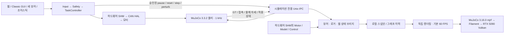

> 현재 기본 `run_visualization.sh`는 실행 중인 장치 세션에 연결합니다. 새 시뮬레이션 세션은 `--simulation`, 정적 미리보기는 `--preview`입니다. 물리 세션은 CAN 관절 좌표와 모델 FK로 갱신하며 GT/외란 조작을 제공하지 않습니다. A=Arm, X=Release이며 SHM ABI 16로 전 프로세스 재빌드가 필요합니다.

# 독립 MuJoCo / Filament 시각화

기본 `scripts/run_daemon.sh`는 물리 CAN 세션을, `scripts/run_simulation.sh`는 기존 Classic GUI가 있는 시뮬레이션을 실행합니다. `qhrr_visualizer`는 별도 프로세스에서 자신의 `mjModel` / `mjData`와 GPU 자원을 소유합니다. 물리·모터·제어 계산식과 게인은 유지하며, 물리 루프에는 승인된 시뮬레이션 조작을 수신하고 실제 상태를 발행하는 IPC 어댑터를 추가했습니다.



SHM ABI는 **16**입니다. 기존 세션을 종료하고 기본 C++ 빌드와 시각화 빌드를 모두 갱신한 뒤 새 세션을 시작하십시오. 구버전 프로세스와 혼용하면 명시적 ABI 오류입니다.

## 준비와 실행

기존 `build/daemon`, `simulation`, `control`, `can_hal` 등은 README의 기본 CMake 빌드로 먼저 준비합니다. 별도 시각화 빌드는 Linux x86_64, Ubuntu 22.04 기반 환경, X11, CMake 3.22+, Ninja, Python 3, Git, dpkg-deb, GLFW3/OpenGL/Vulkan 개발 라이브러리와 NVIDIA Vulkan 드라이버를 요구합니다. `pkg-config --exists glfw3 vulkan`으로 개발 파일을 검사합니다.

```bash
./scripts/build_visualization.sh --jobs 8
./scripts/run_visualization.sh                # 실행 중인 세션 관측
./scripts/run_visualization.sh --simulation   # 새 시뮬레이션 세션
```

첫 빌드는 공식 소스와 도구를 다운로드하므로 네트워크와 수 GiB 디스크가 필요합니다. 소스·의존성·셰이더·실행 파일·로컬 Clang 18.1.8 도구는 Git 제외 대상 `build-filament/`에만 생성합니다. LLVM 패키지는 `visualization/toolchain-lock.json`의 공식 URL과 SHA256으로 검증하고 압축 해제합니다. 호스트 패키지와 시스템 컴파일러는 설치·교체하지 않습니다. 의존성이 준비된 이후 실행에는 다운로드나 자동 재설치가 없습니다. 실행 파일 또는 빌드된 셰이더가 없으면 런처가 자동으로 준비·빌드합니다. `--setup`은 준비 과정을 명시적으로 다시 실행합니다. 빌드 로그와 오류는 그대로 표시하며 다른 백엔드로 전환하지 않습니다. `QHRR_BUILD_JOBS`로 병렬 빌드 수를 지정할 수 있습니다. Python 바인딩 시험 유틸리티는 비활성화하여 시각화에 필요 없는 Eigen 다운로드를 하지 않습니다.

| 명령 | 동작 |
| --- | --- |
| `scripts/run_visualization.sh` | 실행 중인 /qhrr05 세션에 연결 |
| `scripts/run_visualization.sh --simulation` | 호스트 vcan 준비 + 새로운 시각화 시뮬레이션 세션 |
| `scripts/run_visualization.sh --simulation --isolated-vcan --no-terminals` | 격리 CAN 네임스페이스에서 새 시뮬레이션, GPU 창은 현재 X11 디스플레이 |
| `scripts/run_visualization.sh --simulation --existing-can` | 준비된 가상 CAN만 사용한 시뮬레이션 |
| `scripts/run_visualization.sh --simulation --without-can` | 명시적 SHM 토크 디버그 시뮬레이션; 기존 headless 구현처럼 실시간 제한 없이 실행 |
| `scripts/run_visualization.sh --attach --shm-name /qhrr05` | 실행 중인 세션에 조작 가능한 창 추가; 창만 닫으면 세션은 유지 |
| `scripts/run_visualization.sh --preview` | 정적 모델 보기, SHM과 물리 계산 없음 |
| 위 명령에 `--backend classic` | 별도 뷰어에서 기존 `mjv` / `mjr` OpenGL 경로 선택 |

`--attach` / `--preview`는 `--fps 30`, `--width 1920 --height 1080`, `--frames 120`, `--screenshot /tmp/view.ppm`, `--hidden`, `--no-ui`, `--control-config FILE`을 받을 수 있습니다. 새 세션은 `--fps`와 `--backend`를 받습니다. 새 daemon 목록은 `config/daemon/visualization.yaml`이며 원본 모델 `scene.xml`을 headless 물리에 전달하고, `scripts/visualization_process.sh`로 GPU 프로세스를 추가합니다. 시각화 세션에서 창을 닫으면 daemon이 해당 세션을 정리합니다. `--attach` 창을 닫으면 뷰어만 종료합니다.

새 세션의 SHM 이름이나 프로세스 구성을 바꾸려면 목록을 복사해 수정하고 `--config FILE.yaml`로 명시합니다. 실행 중인 세션과 같은 SHM 이름을 재사용하지 않습니다.

시각화 세션은 로그 터미널 6개와 daemon 창을 기본 3열로 배치합니다. 현재 2560×1440 모니터에서는 3행으로 들어갑니다. 작업 영역이 더 작은 환경에서는 `--no-terminals`를 명시하면 별도 로그 터미널을 생략하고 시각화 창은 그대로 실행합니다. 배치 실패 시 자동으로 이 옵션을 적용하지 않습니다.

새 뷰어에는 Classic 개발 GUI와 같은 모드별 그래프, 작업 단축키, 발끝 잔상, 작업공간, 목표 힘 슬라이더와 외란 조작이 있습니다. 명령은 Input → 안전레이어 → TaskController로 보내며 뷰어가 SHM에 명령을 직접 쓰지 않습니다. 웹 패널과 조이스틱도 함께 사용할 수 있습니다. 정적 `--preview`에서는 조작 패널이 기본 숨김이며 Tab으로 표시할 수 있으나 실제 명령은 사용할 수 없습니다.

## 버전과 CMake

| 구성 | 고정 값 |
| --- | --- |
| 물리 / 제어 | 기존 `third_party/mujoco` 3.3.2 |
| 시각화 | MuJoCo 3.16.0, `a892750516336d8358949f4518fcc4fbbd85beae` |
| Filament | MuJoCo가 지정한 rc/1.77.3, `d565729310761fbe8135fd7fc437d5d865349340` |
| 시각화 컴파일러 | 로컬 Clang 18.1.8, 동일한 시스템 libstdc++ 사용 |
| `MUJOCO_USE_FILAMENT` | `ON` |
| `MUJOCO_USE_FILAMENT_MJR_COMPAT` | `OFF` — Classic `mjr_*`를 유지 |

`scripts/build_visualization.sh`가 정확한 MuJoCo HEAD와 수정 여부를 확인합니다. MuJoCo를 CMake 최상위로 구성하고 `cmake/filament_viewer.cmake`의 project hook에서 `visualization/CMakeLists.txt`를 마지막에 포함합니다. 이 방식은 upstream 의존성 스크립트의 최상위 경로 가정을 보존하며 vendor 소스를 패치하지 않습니다. 뷰어는 `mujoco`, `mujoco::filament`, GLFW, Vulkan, OpenGL, pthread를 연결합니다. 물리 실행 파일에는 새 라이브러리를 연결하지 않습니다.

공식 `mjrf` C API와 해당 버전의 `ModelResources`, `ModelLights`, `ModelRenderables`, `ModelDecorations` 지원 클래스를 사용합니다. 지원 클래스는 MuJoCo 내부 C++ 헤더이므로 버전을 임의로 올리면 안 됩니다. 버전 변경 시 API·MJCF 해석·실제 GPU 출력을 다시 검사해야 합니다. 소스 기준은 [MuJoCo 3.16.0](https://github.com/google-deepmind/mujoco/tree/3.16.0), [공식 mjrf 헤더](https://github.com/google-deepmind/mujoco/blob/3.16.0/include/mujoco/mjrfilament.h), [공식 Filament 의존성 정의](https://github.com/google-deepmind/mujoco/blob/3.16.0/cmake/third_party_deps/filament.cmake)입니다. 로컬 도구의 공급원은 [공식 LLVM 패키지 저장소](https://apt.llvm.org/)입니다.

## 상태 동기화와 실행 주기

- SHM에는 실물 하드웨어도 사용하는 `MotorData`, `ModelData`, `ControlData`와 공통 수명 플래그만 있습니다. `SimulationInput`, GT, 접촉 이벤트, 물체 자세, 물리 pause/finished는 SHM에 없습니다.
- 시뮬레이션 전용 교환은 `src/ipc/simulation`의 단일 버전형 `AF_UNIX / SOCK_SEQPACKET` 모듈을 사용합니다. 세션별 경로는 `/tmp/qhrr05-simulation-<uid>/<세션 이름>.sock`이며 디렉터리는 사용자 소유 0700입니다. 프로토콜 버전은 2입니다. 길이·버전·메시지 역할 불일치는 오류로 거부합니다. 세션별 소유권 잠금을 사용하며, 연결 시 `ECONNREFUSED`로 확인된 사용자 소유의 잔여 소켓만 로그를 남기고 제거합니다. 사용 중인 소켓·일반 파일·검증할 수 없는 경로는 보존하고 오류를 냅니다.
- 물리 스레드는 승인 명령을 nonblocking으로 받고 GT를 발행합니다. 구독자가 느리면 최신 상태를 유지하면서 해당 구독자의 `transport_drops`를 증가시킵니다. 구독자의 수신이나 GPU 완료를 기다리지 않습니다.
- 관찰 스레드는 2 ms 간격으로 simulation IPC를 읽고, 하드웨어 SHM은 `trylock`으로 Motor/Model/Control만 짧게 복사합니다. 잠금 해제 후 로컬 mailbox에 합칩니다. 두 경로의 게시 시각·시퀀스는 서로 독립적입니다.
- 렌더러는 로컬 스냅샷으로 자기 `mjData`만 갱신합니다. GPU 작업·리소스 업로드·프레임 제출·readback·FPS 대기는 하드웨어 SHM 잠금 밖이며 별도 프로세스에서 수행합니다. 물리와 렌더러가 같은 `mjData`를 수정하지 않습니다.
- 실제 상태는 `plots.sample_hz`(기본 100 Hz)로 발행합니다. 물리 pause 중에는 벽시계 기준 같은 주기로 정지 상태를 보내고 제어 루프는 계속 동작합니다. FPS가 상태 발행률보다 높으면 같은 자세를 다시 그리며 외삽하지 않습니다.
- 500 ms 이상 새 상태가 없으면 stderr와 창 제목에 `STALE / POSE HELD`를 표시합니다. ABI 불일치·mutex 소유자 사망·failed 세션은 명시적 오류입니다. 시뮬레이션이 없는 하드웨어 세션에서는 모터 제어를 계속할 수 있지만 시뮬레이션 조작은 사용할 수 없습니다.

현재 live 바인딩은 QHRR 고정 베이스 3관절, 관절 속도, touch_object 위치·쿼터니언, 실제 발끝 접촉 합력·토크와 접촉 이벤트를 전달합니다. 다른 관절 수나 mocap 개수는 명시적으로 거부합니다. 임의 MJCF의 정적 미리보기는 가능합니다. 자유 관절, flex/skin 변형, 개별 접촉점 전체는 아직 전달하지 않습니다. 렌더러가 접촉 솔버를 돌려 재구성한 값을 실제 접촉력으로 표시하지 않습니다.

시뮬레이션 조작은 Input에서 Safety와 TaskController를 거쳐 승인된 뒤 같은 simulation IPC의 명령 패킷으로 전달됩니다. UI의 안전 승인은 물리 적용 완료와 구분하며, 적용 시퀀스와 실제 외력은 시뮬레이터가 별도로 발행합니다. 외란은 한 뷰어가 소유하며 500 ms lease를 사용합니다. 마우스 해제·포커스 상실·종료 시 해제하고, UI가 멈춰 갱신하지 못하면 lease 만료로 해제합니다. 유한값·유효 body·단위 쿼터니언을 검사하며, 단일 스텝은 pause 상태에서만 허용합니다. 기존 모션별 안전 검사는 유지합니다.

## 안티앨리어싱과 내부 해상도

Filament 기본값은 **8x MSAA + 고정 4/3배 내부 렌더 해상도**입니다. 1920×1080의 3D viewport는 내부에서 약2560×1440으로 렌더한 뒤 축소합니다. 그래프 패널을 펼치면 3D viewport 폭만 기준으로 계산되며 UI는 창의 원래 해상도로 그립니다. 16-bit HDR 버퍼와 HDR MSAA resolve를 사용합니다. FXAA/TAA/샤프닝은 기본적으로 끕니다. 세부 기능은 고정된 Filament [View/Options API](https://github.com/google/filament/blob/main/filament/include/filament/Options.h)를 사용합니다.

```bash
# 기본 스튜디오: 8x MSAA, 내부 1.333333배
./scripts/run_visualization.sh

# 최대 2배 SSAA: 1920×1080 창이면 내부 3840×2160
./scripts/run_visualization.sh --preview --width 1920 --height 1080 --msaa 8 --render-scale 2

# 4x MSAA, 내부 해상도 확대 없음
./scripts/run_visualization.sh --msaa 4 --render-scale 1
```

`--msaa`는 1/2/4/8, `--render-scale`은 1~2입니다. 새 세션·attach·preview에 모두 적용됩니다. 명시적으로 낮은 값을 요청할 수 있지만 기본값이 성능에 따라 자동으로 낮아지지는 않습니다. 요청한 MSAA의 GPU 지원과 고정 배율 적용을 검사하며 거부되면 오류로 종료합니다. 실제 viewport와 내부 해상도는 로그에 표시됩니다. Classic은 MSAA를 사용하지만 이 내부 해상도 확대 기능은 제공하지 않습니다.

스크린샷도 동일한 MSAA와 내부 배율을 사용합니다. 고정 MuJoCo 3.16의 `mjrf` render-target 경로는 MSAA를 비활성화하므로, 저장할 때만 읽기 가능한 headless swapchain과 동일한 `SceneView`를 사용합니다. readback의 GPU 대기는 독립 시각화 프로세스에서만 일어납니다. 이 어댑터는 고정 버전의 내부 API에 의존하므로 MuJoCo 업데이트 시 GPU 검증을 함께 수행해야 합니다.

## PBR, 조명과 자원

`scene_pbr.xml`은 원본 `scene.xml`과 별도 `visualization/pbr_assets.xml`을 포함합니다. 새 MJCF는 렌더러만 로드합니다. 렌더링 모델에서 metal/black/white/gray/ground를 대응 PBR 재질로 매핑하며 기존 물리 모델 XML을 수정하지 않습니다.

- 로봇: 은색 알루미늄, 검정 아노다이징 하우징, 짙은 금속 몸체를 구분합니다. Base Color는 상수이며 색상에 브러시 무늬를 그리지 않습니다. 은색과 몸체에만 [ambientCG Metal009](https://ambientcg.com/view?id=Metal009)의 CC0 **4096×4096 Roughness**를 서로 다른 좁은 범위로 가공해 적용합니다. `roughness=1`이므로 맵 값이 그대로 유효 거칠기입니다. 금속 Normal Map은 사용하지 않습니다. 코팅 하우징은 등방성, 순수 금속만 약한 이방성(최대0.20)을 사용합니다. `pbr_white`는 텍스처 없는 도장 재질입니다.
- 바닥: 중간 회색 무광 스튜디오 바닥(Base Color sRGB 135/136/137), 고정 Roughness 0.90. 512×512 Base Color, Normal, Ambient Occlusion 레이어로 눈에 띄는 얼룩·타일 무늬를 억제합니다. 배경은 중립 회색 skybox(0.29/0.30/0.31)로, 조명받은 바닥과 밝기가 비슷하도록 맞췄습니다. 물리 바닥 형상은 유지합니다.
- 환경: 기본값은 어두운 반사 영역과 경계가 완만한 소프트박스 조명판을 수학적으로 생성한 `product_studio_ibl.ktx`입니다. 작은 창문·패널의 고대비 반사띠를 없애고 512px GGX prefiltered cubemap/irradiance SH로 제공합니다. `python3 tools/prepare_product_studio_ibl.py`로 네트워크 없이 재생성합니다. 기존 CC0 Studio Small 09도 보관하며 `--ibl`로 명시적으로 선택할 수 있습니다.
- 조명: 사선 soft key(22000) + 약한 차가운 fill(3000) + 중립 rim(1500) + IBL(40000). 밝은 배경에 맞췄던 주광·환경광을 낮추고 fill은 유지해 어두운 금속 부품의 디테일을 살립니다. 노출은 0 EV를 유지합니다. Fill/rim은 렌더러가 소유하는 고정 스튜디오 조명이며 시뮬레이터에는 없습니다. 2048 shadow map의 PCSS 소프트 그림자와 AO, 중립 ACES를 사용합니다. 카메라 headlight·bloom·vignette·fog·샤프닝은 끕니다. MuJoCo 3.16의 색보정 LUT가 이전 설정으로 생성되는 부분은 설정을 한 번 재적용하여 MJCF 값이 실제 출력에 적용되도록 합니다.
- 접촉 물체: 채도를 줄인 무광 주황색 블록. 물리 접촉 형상·마찰·입력은 동일합니다.
- 원본 CAD 버텍스·삼각형·관절/충돌 형상은 변경하지 않습니다. 기존 모따기와 곡면을 유지하고 MuJoCo의 법선·UV 투영을 이용합니다. 새로운 bevel이나 소재별 CAD 재분할 작업을 수행한 것은 아닙니다.
- Classic 개발용 렌더러와 원본 모델은 유지합니다. PBR 채널은 Filament가 처리합니다.

| 재질 | Base Color RGB | Metallic | 유효 Roughness |
| --- | --- | --- | --- |
| 은색 링크 | 0.78 / 0.80 / 0.82 | 1.0 | 0.322~0.380, 평균0.349 |
| 검정 하우징 | 0.12 / 0.13 / 0.14 | 0.85 | 고정0.42 |
| 짙은 금속 몸체 | 0.48 / 0.50 / 0.53 | 1.0 | 0.357~0.404, 평균0.380 |
| 도장 커버 | 0.82 / 0.83 / 0.84 | 0 | 고정0.50 |
| 고무 | 0.035 / 0.038 / 0.043 | 0 | 고정0.88 |

OBJ에는 authored UV가 없으므로 `texrepeat`는 0~1 UV 타일 개수가 아니라 생성된 `uv=0.5*position-0.5`의 배율입니다. 은색·몸체는 10배, 즉 200mm 투영 타일을 사용합니다. MuJoCo 3.16의 UV 배율 적용 조건 때문에 단색 흰 RGB 텍스처를 연결하지만, 실제 색상 무늬는 없습니다. Roughness는 linear, 바닥 색상은 sRGB입니다. 검정 하우징은 은색 텍스처를 공유하지 않습니다.

바닥 맵은 `python3 tools/generate_pbr_textures.py`, 금속 맵은 `python3 tools/prepare_metal_materials.py`로 재현합니다. 금속 도구의 `--download`를 명시하면 고정 해시의 CC0 원본을 받습니다. 이전 색상·아노다이징·바닥 Roughness 파일은 비교용으로 보관하지만 활성 MJCF에서는 참조하지 않습니다. 생성 IBL 및 기존 HDRI의 출처·SHA256과 변환 방법은 [환경 자산 기록](../models/qhrr-05/visualization/environment/README.md)에 있습니다. `python3 tools/prepare_studio_ibl.py`를 명시적으로 실행할 때만 HDR 원본을 다운로드해 변환합니다. 일반 실행은 포함된 KTX를 읽으며 인터넷 연결이 필요하지 않습니다. 환경 파일이 없으면 오류로 종료합니다.

정적 메시와 텍스처는 초기화 시 `ModelResources`에 한 번 등록합니다. 프레임마다 링크·카메라·조명과 디버그 geometry를 갱신하며 모델 메시·텍스처를 다시 업로드하지 않습니다. 시각화 프로필에서만 기존 light의 방향·색·광원 크기와 skybox 선택을 갱신하며 원본 물리 MJCF는 수정하지 않습니다.

재질 색·금속성·거칠기·텍스처 반복은 `visualization/pbr_assets.xml`, 조명의 방향·색·광원 크기와 강도·노출은 `scene_pbr.xml`의 `pbr.key.*`, `pbr.fill.*`, `pbr.rim.*`, `filament.*` 항목에서 조정합니다. 변경은 새 시각화 창을 열 때 적용됩니다. 기존 창의 GPU 자원은 실행 도중 교체하지 않습니다.

금속용 `visualization/materials/brushed_pbr.mat`는 고정된 MuJoCo PBR 셰이더의 입력 채널을 유지하면서 [Filament 이방성 반사](https://google.github.io/filament/main/materials.html#materialmodels/litmodel/anisotropy)와 specular AA를 추가합니다. 브러시 방향은 UV/위치의 화면 미분에서 접선 공간으로 변환하며 UV가 퇴화해 방향을 정의할 수 없는 면은 등방성으로 계산합니다. 이 동작은 물리·제어 모델과 독립적입니다.

셰이더는 upstream `matc`로 OpenGL / Vulkan용 `.filamat`을 빌드하며 실행 파일 옆 `assets/`에 `ibl.ktx`와 함께 배치합니다. `filament:` resource provider가 이 디렉터리를 읽습니다. PBR은 명시적으로 `qhrr_pbr.filamat`을 사용하며 이 파일이 없으면 기존 PBR로 몰래 대체하지 않습니다. 런처는 누락된 커스텀 셰이더도 재빌드합니다. 현재 작업 디렉터리에 의존하지 않습니다. `--assets DIRECTORY`로 명시적 디렉터리를 선택할 수 있으며 자원이 없으면 오류입니다.

사용자 HDRI는 Filament `cmgen` 등으로 **prefiltered IBL KTX**를 만든 뒤 다음처럼 지정합니다. 원본 `.hdr` / `.exr` 파일을 직접 넘기는 기능은 제공하지 않습니다. 런처의 기본 product-studio IBL 대신 지정한 환경이 사용되며 로드한 경로를 로그에 표시합니다. 별도 MJCF에 image light가 명시돼 있으면 해당 MJCF 환경을 사용하고, `--ibl`은 legacy light용 간접광 텍스처만 교체합니다.

```bash
./scripts/run_visualization.sh --attach --ibl /absolute/path/studio_ibl.ktx
```

## 조작과 그래프

| 조작 | 기능 |
| --- | --- |
| D / H / G / M / T / B / Z | Damping / Homing / Gravity / Magnetic / Tracking / Ball / Zero set |
| 1 / 2 / 3 | Tracking XY / XZ / YZ |
| Space / R / 오른쪽 방향키 | 물리 pause·resume / reset 후 Damping / 1 ms 단일 스텝 |
| 더블클릭 | 몸체 또는 주황색 touch_object 선택 |
| Ctrl + 오른쪽 드래그 | 선택 몸체에 힘; mocap 물체 이동 |
| Ctrl + 왼쪽 드래그 | 선택 몸체에 토크; mocap 물체 회전 |
| Ctrl + Shift + 드래그 | 수평 방향 조작 |
| W / L | 작업공간 / 발끝 2초 잔상 표시 전환 |
| Tab | 그래프·조작 패널 표시 전환 |
| 왼쪽 / 오른쪽 / 가운데 드래그·휠 | Orbit / Pan / Zoom |
| Shift + 드래그 | 카메라 수평 방향 전환 |
| F / Home | FL_calf 추적 카메라 / 기본 카메라 |
| Alt + 0..5 | geom group 표시; collision group 3은 기본 숨김 |
| V / C / S | body frame / 실제 접촉 합력·토크 / 그림자 |
| F12 | PPM 캡처 (`--screenshot` 경로 또는 `artifacts/visualization-capture.ppm`) |
| Escape / 창 닫기 | 뷰어 종료 |

D/H/G는 관절각·피드백 토크, M은 추정/실제/목표/명령 힘과 발끝 위치·오차, T는 평면 경로·위치·오차·동역학 토크 사용률, B는 발끝·공 목표와 토크를 표시합니다. Classic의 `LivePlots`, `ToeTrail`, `WorkspaceOverlay` 계산을 재사용하며 Filament에서는 별도 ImGui 계층으로 그립니다. 모드 재진입·평면 변경·리셋 시 이력도 Classic과 같은 규칙으로 초기화합니다. 목표 힘 슬라이더, 궤적 검사 진행률, IK/ILC/RFOB와 최근 승인·거부 결과도 표시합니다.

T/R과 숫자 키는 기존 개발 GUI의 작업 키입니다. 카메라 추적은 F, 카메라 복귀는 Home을 사용합니다. 일반 MuJoCo의 파일 불러오기·모델 편집 메뉴는 이 독립 창에 포함하지 않습니다.

## GPU 검사와 시험

Filament 프로세스 런처는 NVIDIA ICD를 `VK_DRIVER_FILES`와 `VK_ICD_FILENAMES`에 명시합니다. 기본 경로는 `/usr/share/vulkan/icd.d/nvidia_icd.json`이고 `QHRR_NVIDIA_ICD`로 명시적으로 변경할 수 있습니다. C++ 초기화는 Vulkan 장치가 하나이며 NVIDIA discrete RTX 5090인지 확인하고, `mjrf_getRendererInfo`로 Vulkan 사용을 재확인합니다. llvmpipe·다른 GPU·OpenGL로의 자동 전환은 없습니다. RTX의 RT 코어를 이용하는 ray tracing 렌더러는 아니며 Vulkan raster PBR 가속입니다.

```bash
nvidia-smi
VK_DRIVER_FILES=/usr/share/vulkan/icd.d/nvidia_icd.json vulkaninfo --summary
./build-filament/native/bin/visualization_snapshot_test
./scripts/run_visualization.sh --preview --frames 120 --screenshot /tmp/qhrr-filament.ppm
./scripts/run_visualization.sh --preview --backend classic --frames 60
```

`visualization_snapshot_test`는 consumer 지연 중 생산자 진행, 동시 발행 스냅샷 일관성, mutex busy 처리, 소유자 사망·ABI 오류와 명령/세션 불변을 검사합니다. `--slow-render-ms N`은 GPU 프로세스에만 인위적 지연을 주는 검증 옵션입니다.

이전 4x MSAA 프로필 검증 기록: 2026-10-29 실제 X11 / NVIDIA 드라이버 580.82.09 / RTX 5090에서 Filament Vulkan과 Classic OpenGL의 이미지 출력을 확인했습니다. 200 ms/프레임 지연 통합 시험에서는 기준 대비 물리 실제 시간 비율이 0.9992 → 0.9985, 모델 발행률 999.0 → 998.3 Hz, 제어 발행률 480.7 → 480.0 Hz였습니다. 설정 제어 주파수는 500 Hz이며 실제 측정 발행률을 기록한 값입니다. 지연 중 렌더링은 38프레임, 관찰자의 최대 SHM 잠금 시간은 약 29.8 µs였습니다. 이 결과는 해당 부하에서 GPU 대기가 물리 루프를 직렬로 막지 않음을 확인한 것이며 OS 스케줄링의 실시간 보장을 뜻하지 않습니다.

기본 1600×1000 해상도·60 FPS 제한의 별도 정적 미리보기 시험에서는 300프레임을 5.43초에 출력했습니다(초기 프레임 준비와 종료를 포함한 평균 약 55.3 FPS). 창 크기 900×650 변경, orbit/pan/zoom, 추적/카메라 복귀와 디버그 표시도 실제 창 이벤트로 확인했습니다.

스튜디오 IBL·매트 아노다이징 재질·PCSS 조정 후 같은 해상도의 미리보기는 300프레임/5.27초(평균 약 56.9 FPS)였습니다. 조정 후 GPU 통합 시험도 통과했으며 200ms 지연 중 모델 발행률은 999.65Hz, 제어 발행률은 480.32Hz, SHM 잠금 최대 시간은 33.4µs였습니다. 원본 물리 MJCF·제어 로직은 재질 조정에서 변경하지 않았습니다.

```bash
bash tests/run_can_hal_vcan_test.sh python3 tests/visualization_gpu_test.py
```

GPU 통합 시험은 별도 SHM과 임시 daemon/로거 설정을 사용합니다. 현재 사용자의 세션에 붙지 않으며 호스트 CAN 구성을 바꾸지 않습니다.

실제 창 조작 통합 시험은 다음과 같습니다. 별도 세션에서 모드·평면, pause·정확한 단일 스텝, 힘·토크 외란, 물체 이동·회전, 작업공간, 리셋과 attach 창 독립 종료를 검사합니다. 시험 후 원래 포커스와 포인터 위치를 복구합니다.

```bash
bash tests/run_can_hal_vcan_test.sh python3 tests/visualization_operator_test.py
ctest --test-dir build --output-on-failure -R 'simulation_ipc|safety_layer|simulator_gui'
```

IPC 분리 및 UI 통합 후 전체 CTest 36개, 웹 시험 3개와 실제 Filament·독립 Classic 조작 시험을 모두 통과했습니다. 같은 GPU 지연 시험의 최신 결과는 물리 998.33 → 999.00 Hz, 제어 470.37 → 469.52 Hz, 최대 SHM 잠금 11.4 µs입니다. 환경 부하에 따라 측정 주파수가 달라지므로 설정 주파수와 구분합니다.

시작 중 `simulation: Broken pipe`가 나오면 함께 표시되는 `startup log` 경로에서 시뮬레이터의 실제 오류를 확인하십시오. 비정상 종료 후 리스너 없이 남은 simulation IPC 소켓은 새 버전에서 자동 복구합니다. 이 처리로 실행 중인 다른 시뮬레이터의 소켓을 교체하지 않습니다.

품질/저장 경로의 실제 GPU 검증은 `python3 tests/visualization_quality_test.py`로 실행합니다. 1x/4x/8x MSAA, 2배 SSAA, 홀수 폭 RGB 저장, 옵션 오류 거부를 확인합니다. 비교 이미지는 `artifacts/studio-quality/`에 있습니다.

최신 8x MSAA/스튜디오 프로필 검증: RTX 5090에서 1920×1080 창의 내부2560×1440 및 3840×2160을 확인했습니다. 기본 배율 120프레임은 2.58초(초기 프레임·스크린샷 포함), 4K 내부 해상도 8프레임은 0.74초였습니다. 200ms/프레임 렌더 지연 전후 물리 실제 시간 비율은 0.99982→0.99983, 제어 발행률은 469.83→470.66 Hz였고, 지연 중 최대 SHM 잠금은 18.8μs였습니다. ABI13 모델 발행률은 제어기 주기와 같은 약470Hz입니다. 품질/이미지 저장, 기존 Classic, 자동 빌드, 실제 그래프·키보드·Ctrl 외란·작업공간 회귀를 통과했습니다. 새 CAD에 가려진 예전 고정 클릭 좌표는 테스트에서 ray hit를 확인하는 방식으로 보정했습니다.

## 은색 표면의 반사띠 진단

동일한 모델/카메라에서 Normal Map만 제거, 모든 은색 텍스처 제거, IBL 제거를 각각 비교했습니다. 은색 영역의 원본 대비 평균 RGB 차이는 Normal Map 제거 약0.51/255, 전체 텍스처 제거 약0.64/255, IBL 제거 약65.2/255였습니다. 넓은 띠의 주원인은 기존 HDRI의 고대비 반사였습니다. 비교 이미지는 `artifacts/silver-finish-diagnosis/`에 보관합니다.

현재 금속은 원본의 미세 브러시 결을 유지한 4K 맵을 사용합니다. `texuniform=false`, `texrepeat=25 25`로 설정하며 자동 투영 `uv=0.5*p-0.5` 기준 타일은 투영 좌표상 약80mm, 원본 텍셀은 약20μm입니다. mesh bounding box 크기를 다시 곱하지 않습니다. `tools/prepare_metal_materials.py`는 다운받은 CC0 원본을 검증하고 중립 Color와 좁은 범위의 Roughness를 재생성합니다. 최초 원본 다운로드는 `--download`를 명시해야 하며, 실행 시 다운로드는 없습니다. 출처·라이선스·SHA256은 `textures/brushed_metal.json`에 기록합니다. 이전 512px/6.25mm 무작위 맵은 금속 기본값에서 제외했습니다.

지난 설정은 반사를 너무 퍼뜨려 금속이 무광 도장처럼 보였으므로, 현재는 거칠기를 낮추고 512px IBL의 넓은 소프트박스와 어두운 반사 영역을 함께 사용합니다. 불규칙한 작은 창문 무늬 대신 명확한 하이라이트와 금속의 명암 변화를 줍니다.

메시 법선을 별도로 재생성하거나 CAD 형상/물리/제어를 변경하지 않았습니다. 기존 mesh의 홈·볼트·가공 형상은 그대로 보존합니다.
