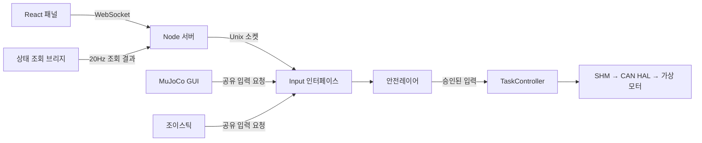

# 웹 제어 패널

웹과 입력 코드는 `interfaces`로 묶었습니다. C++ Input/조이스틱은 `src/interfaces/input`, 읽기 전용 웹 브리지는 `src/interfaces/web_gui`, 실행 진입점은 `apps/interfaces/{input,web_gui}`입니다. Node/React 프로젝트는 `apps/interfaces/web_gui/frontend`에 있습니다. 실행 파일 이름(`input`, `web_gui_bridge`)과 `scripts/run_web_gui.sh` 명령은 유지됩니다.


`GUI` 브랜치의 로컬 React/Vite 패널입니다. Damping·Homing·Gravity·Magnetic·Tracking·Ball·Zero set 모드 요청, Tracking 평면 선택, 목표 접촉력 설정, 관절/CAN 상태와 최근 명령 기록을 제공합니다. 상태 표시는 20Hz이며 실제 제어 주기는 기존 TaskController 설정을 따릅니다.

## 화면과 조작

[Flip7 디자인 문서](flip7-card-game-DESIGN.md)의 청록·크림·금색, 둥근 카드와 색상 테두리를 제어 화면에 맞게 적용했습니다. 현재 모드는 청록 요약 카드와 금색 모드 카드로 함께 표시하며, 오류·미확인 결과는 문구와 코럴색으로 구분합니다. 반복 점멸이나 게임 연출은 넣지 않았습니다.

- 상단에서 현재 모드, Enabled 모터 수, 접촉, 시뮬레이션 시간을 확인합니다. 명령의 요청 전송 → 안전 승인 → 모드 반영은 조작부 바로 위에 표시합니다. 힘 요청은 안전 승인까지만 확인하며 실제 접촉력 도달로 표시하지 않습니다.
- 모드 카드를 누르면 즉시 전환을 요청합니다. D/H/G/M/T/B 단축키도 지원하며, 숫자 1/2/3은 XY/XZ/YZ Tracking을 요청합니다. 입력란을 편집하는 동안에는 단축키가 작동하지 않습니다.
- Tracking 평면 버튼은 선택만 바꿉니다. `Tracking 시작`을 눌러 전환을 요청하며 현재 추종 평면을 별도로 표시합니다.
- 목표 힘은 숫자, 슬라이더, ±0.5 N 버튼으로 편집합니다. `목표 힘 적용`을 누르기 전까지 명령을 보내지 않고 미적용 변경을 표시합니다. 설정 범위 밖 값은 오류를 표시하고 적용 버튼을 비활성화합니다.
- 관절 표는 모바일에서 관절별 카드로 바뀝니다. 위치 그래프에는 각각의 세로축 범위와 최근 최대 100개 수신 표본을 표시합니다. 연결이 끊기면 조작을 비활성화하고 현재 측정값·편집값을 비웁니다.

키보드 포커스 표시, 44px 이상의 주요 터치 영역과 `prefers-reduced-motion`을 지원합니다. 320/390/768/1280/1440px 화면 폭, 실제 단축키 입력, 편집 중 명령 차단, 미적용 값과 범위 오류를 브라우저 시험으로 확인합니다. 백엔드·Input·안전레이어·SHM/시뮬레이션 IPC 계약은 디자인 변경에서 유지합니다.

## 실행

Node.js 22.12 이상과 기존 C++ 빌드 환경이 필요합니다. 기존 daemon을 빌드하고 실행합니다.

```bash
cmake -S . -B build -DCMAKE_BUILD_TYPE=Debug
cmake --build build --parallel 2
./scripts/run_daemon.sh
```

daemon이 실행 중일 때 별도 터미널에서 웹 서버를 실행합니다.

```bash
./scripts/run_web_gui.sh --setup
```

최초 한 번 `--setup`으로 상태 조회 브리지를 빌드하고 `package-lock.json`의 npm 의존성을 설치합니다. 이후에는 `./scripts/run_web_gui.sh`로 시작합니다. 스크립트는 매번 프런트엔드를 빌드해 최신 화면을 제공합니다. 일반 시작 중 의존성이 없거나 버전이 다르면 오류와 준비 방법을 알리며, 네트워크 설치는 명시적 `--setup`에서만 수행합니다.

브라우저에서 `http://127.0.0.1:8080`을 엽니다. 스크립트는 daemon을 시작하거나 종료하지 않습니다. 웹 서버는 현재 daemon 프로세스 목록에 자동 추가하지 않았습니다. 서버 종료는 해당 터미널의 Ctrl+C로 처리합니다. 브라우저를 닫아도 기존 제어 모드는 계속됩니다.

다른 세션이나 설정을 사용할 때는 실행 중인 TaskController와 같은 값을 전달합니다. 스크립트는 어느 작업 디렉터리에서 호출해도 되며, 옵션의 상대 경로는 저장소 루트 기준입니다.

```bash
./scripts/run_web_gui.sh --shm-name /qhrr05 --port 8080 \
  --control-config config/control/control.yaml
```

`--bridge PATH`로 상태 조회 실행 파일, `--input-socket PATH`로 Input 엔드포인트를 명시할 수 있습니다. `--help`에서 전체 옵션을 확인합니다. 서버는 `127.0.0.1`에만 바인딩합니다. 이미 사용 중인 포트나 없는 SHM은 오류로 보고합니다. 준비가 끝난 상태에서 Node 서버만 실행하려면 `npm --prefix apps/interfaces/web_gui/frontend start`도 사용할 수 있습니다.

프런트엔드 개발 시 서버를 8080에서 실행한 뒤 다른 터미널에서 `npm --prefix apps/interfaces/web_gui/frontend run dev`를 실행합니다. Vite는 5173을 사용하며 `/ws`를 로컬 서버로 전달합니다. 포트를 자동 변경하지 않습니다.

## 입력과 안전 판정



Node 서버는 명령을 SHM에 쓰지 않습니다. `web_gui_bridge`는 하드웨어 SHM과 시뮬레이션 IPC의 상태를 로컬에서 조합·직렬화하며, 표준입력으로 명령을 넣으면 명시적 오류로 종료합니다. Node 서버의 명령 경로는 Input 소켓 하나입니다. Input 연결 실패를 직접 SHM 쓰기로 대체하지 않습니다.

TaskController가 `InputInterface` 엔드포인트를 소유하고 자기 입력 단계에서 대기 없이 수신합니다. 기본 경로는 `/tmp/qhrr05-input-<uid>/<SHM 이름에서 선행 /를 제거한 값>.sock`입니다. 디렉터리는 현재 사용자 소유의 0700이며 같은 사용자만 연결할 수 있습니다. 기존 소켓 파일은 자동 삭제하거나 재사용하지 않고 충돌로 보고하며, 정상 종료 시 자신이 만든 소켓을 해제합니다.

MuJoCo GUI·독립 시각화 창·조이스틱도 Input 인터페이스를 사용합니다. TaskController가 안전 검사를 통과한 입력만 채택합니다. 시뮬레이션 전용 명령과 GT·물체·접촉 상태는 통일된 simulation IPC로 전달하며 SHM에 넣지 않습니다. 현재 SHM ABI는 13이므로 모든 프로세스를 재빌드하고 함께 재시작해야 합니다. 시뮬레이션이 없는 하드웨어 세션에서는 시뮬레이션 시각·접촉 GT를 사용할 수 없음으로 표시합니다.

합의한 기본 정책은 아래와 같습니다.

| 검사 | 승인 조건 |
| --- | --- |
| 세션 | failed/stopping이 아님. 웹 요청은 모델 상태도 준비되어 있어야 함 |
| 명령 형식 | 지원 명령, 필요한 필드, 정수 모드·평면, 불필요한 필드 없음 |
| 모드 / 평면 | 모드 0~5, 평면 XY/XZ/YZ |
| 목표 힘 | 유한값, 0 이상, `magnetic_touch.maximum_force_n` 이하 |
| 조이스틱 | 축 유한값 −1~1, 트리거 유한값 0~1 |
| 공 목표 | 모든 좌표가 유한값 |

거부된 입력은 실행하지 않고 마지막 승인 입력을 유지하며 이유를 기록합니다. IPC·자원 오류는 별도 실패로 전파합니다. Homing 선행 강제나 응답 경과 시간 기반 차단 정책은 추가하지 않았습니다. 모션별 기존 작업공간·궤적·IK 검사와 토크 제한은 계속 적용합니다.

기존 `can_hal --target/--release`는 TaskController를 실행하지 않는 수동 진단 경로입니다. 웹 패널에서 호출하지 않습니다. 물리 일시정지·리셋·단일 스텝·외란은 Classic GUI 또는 독립 시각화 창에서 조작합니다.

## 명령 결과 표시

참고 자료 [QHRR_operations_demo.html](QHRR_operations_demo.html)의 상태 요약, 처리 단계, 이벤트 기록을 반영했습니다. 실제 SHM에 존재하는 3개 관절과 현재 모션만 표시하며 데모의 합성 버스·Arm/ESTOP 상태 머신은 구현하지 않았습니다.

- **요청 전송:** 브라우저가 요청 ID와 명령을 송신했습니다.
- **안전 승인:** Input 응답의 `safety_approved`를 확인했습니다. 아직 모션 완료를 뜻하지 않습니다.
- **Task 반영:** 모드 요청의 sequence·실제 모드·평면이 TaskController 발행 상태와 일치합니다. 궤적 검사나 실제 이동은 계속 진행될 수 있습니다.
- **거부 / 결과 미확인:** 안전 거부와 응답을 확인하지 못한 경우를 구분합니다. 전송 후 연결이 끊긴 요청은 자동 재전송하지 않습니다.

목표 힘은 승인 상태까지만 확정해 표시합니다. 설정 요청값의 표시를 실제 접촉력 도달로 취급하지 않습니다. 서버 연결이 끊기면 조작을 비활성화하고 현재값 표시를 지웁니다. 다시 연결은 사용자가 선택합니다. 서버 연결 표시와 SHM 스냅샷은 모터의 물리적 동작 완료를 보증하지 않습니다.

Input 소켓의 내부 요청은 한 연결당 한 줄입니다. 예: `1 mode 5 0\n`, `2 force 3.0\n`. 응답은 같은 ID의 JSON 한 줄이며 `ack` + `stage: safety_approved` 또는 거부 이유를 담은 `error`입니다. 이는 내부 전송 계약이며 서버의 사용자 API는 WebSocket JSON입니다.

## 검증

```bash
ctest --test-dir build --output-on-failure -R '^(safety_layer|control_io|simulator_gui|can_gui|can_control_integration|can_ctc_integration|can_impedance_integration|ball_following|virtual_mit_motor)$' -j 2
npm --prefix apps/interfaces/web_gui/frontend test
npm --prefix apps/interfaces/web_gui/frontend run test:browser
```

CAN·SHM·GUI 시험에는 로컬 실행 권한이 필요합니다. 브라우저 시험은 `/opt/google/chrome/chrome`을 사용하며 다른 Chrome/Chromium은 `QHRR_CHROME`에 경로를 지정합니다. 시험은 별도 SHM과 실제 TaskController를 사용하고 테스트 상태 발행기만 합성합니다. 실물 모터를 조작하지 않습니다. 브라우저 시험의 데스크톱·모바일 캡처는 Git 제외 디렉터리 `build/web_gui_desktop.png`, `build/web_gui_mobile.png`에 저장합니다.

Zero set(Z)은 hip → thigh → calf 스토퍼 탐색과 런타임 영점 보정입니다. 보정 단계/축/실패 사유를 패널에 표시하며, 미보정 상태에서도 D로 중단하거나 Z로 재시도할 수 있습니다. 세 축 보정 전 일반 모션은 거부됩니다. 자세한 설정은 [제어 문서](control.md#스토퍼-기반-zero-set)를 참고하십시오.
