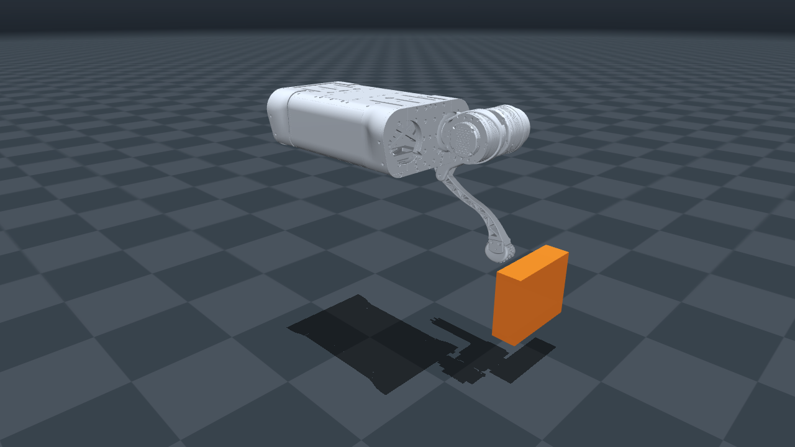

# qhrr-05

사용자가 제공한 `qhrr-05_new.zip`의 SolidWorks CAD 기반 몸통 + FL 다리 모델입니다. 기존 `models/qhrr-05` 경로를 유지하며, 시뮬레이션·제어기·Classic·Filament가 같은 로봇 모델을 사용합니다.

## 모델과 호환 이름

- 진입점은 기존 `qhrr-05.xml`, `scene.xml`, `scene_pbr.xml`입니다.
- 몸통은 고정 베이스이고 `nq=nv=nu=3`, HR/HP/KP의 qpos·qvel 주소는 0/1/2입니다.
- 기존 body 이름 `base`, `FL_hip`, `FL_thigh`, `FL_calf`, 관절 `FL_hip_joint`, `FL_thigh_joint`, `FL_calf_joint`, 모터 `FL_hip`, `FL_thigh`, `FL_calf`, 발 접촉 `FL`, 발끝 site `FL_foot`를 유지합니다.
- 원본 MJCF의 body `hip/thigh/calf`를 기존 `FL_*` 이름에 맞추고 contact exclude의 참조도 함께 맞췄습니다. 별도 제공된 `qhrr-05.urdf`는 원본 파일 그대로 보관합니다.
- 원본 `qhrr_metal`을 기존 `gray` 재질에 연결했습니다. 기존 `metal/black/white/gray` 재질 이름과 PBR 재질 매핑을 유지합니다.
- `scene.xml`의 바닥·접촉 물체와 `scene_pbr.xml`의 조명·IBL 설정을 유지합니다. 로봇의 관성은 모두 명시값을 사용하며, compiler의 `inertiafromgeom=auto`는 기존 장면 물체의 자동 관성 계산을 유지하기 위한 설정입니다. 로봇 body의 질량·관성을 메시에서 재추정하지 않습니다.

## 새 기구와 동역학

단위는 m, kg, kg·m²입니다. 새 모델의 관절 원점·질량·COM·full inertia·관절 범위·접촉 형상을 함께 반영했습니다. 이전 Go2 형상의 제어 응답과 같다고 가정하지 않습니다. 제어 게인과 알고리즘은 모델 교체에서 변경하지 않았습니다.

| body | 질량 [kg] | 부모에 대한 원점 [m] |
| --- | --- | --- |
| base | 8.163921 | 월드 `(0, 0, 0.55)` |
| FL_hip | 1.06311951886917 | `(0.1912, 0.0625, 0)` |
| FL_thigh | 2.176288 | `(0.06, 0.0262, 0)` |
| FL_calf | 0.316044433148062 | `(0, 0.0903, -0.22)` |

| 관절 | 축 | 범위 [rad] |
| --- | --- | --- |
| FL_hip_joint | `(1, 0, 0)` | `[-0.872665, 0.872665]` |
| FL_thigh_joint | `(0, 1, 0)` | `[-2.984513, 2.879793]` |
| FL_calf_joint | `(0, 1, 0)` | `[-2.722714, -0.575959]` |

시간 간격은 1 ms, `home`은 `[0, 0.9, -1.8] rad`, keyframe 토크는 0입니다. `damping=2`, `frictionloss=0.2`, `armature=0.01`, XML 토크 한계 ±53.7 Nm를 유지합니다. 이 값들은 모터 측정값이나 CAN 프로파일과 별개의 시뮬레이터 설정입니다. 실제 초기각·호밍각은 [control.yaml](../../config/control/control.yaml)에서 읽습니다.

발끝·발 접촉 구 중심은 calf 좌표계의 `(-0.00403072499058543, 8.18446382888638e-9, -0.233011802519609)`입니다. 발 반지름은 약 0.02113237 m이고 `condim=6`입니다. 나머지 접촉은 원본 box/capsule 근사이며 몸통–hip 접촉 제외를 유지합니다. 기존 장면의 주황색 접촉 물체는 그대로이므로 새 기구의 일부 자세에서는 닿을 수 있습니다.

## 에셋과 출처

활성 시각 메시 4개는 압축 파일의 `qhrr_base.obj`, `qhrr_hip.obj`, `qhrr_thigh.obj`, `qhrr_calf.obj`를 바이트 그대로 복사했습니다. 약 108만 삼각형이며 간소화·정점 변환·파일명 변경을 하지 않았습니다. 이전 OBJ 9개는 원본 이름과 내용 그대로 보관하지만 새 MJCF에서 사용하지 않습니다.

- [mass_properties.json](mass_properties.json): 제공된 링크 질량·관성·좌표계·메시 SHA256.
- [cad_source_properties.json](cad_source_properties.json): 제공된 CAD 추출 근거.
- [provenance.json](provenance.json): 압축 파일·실행 MJCF 해시, 이름 호환 변경, 활성 메시와 기존 자산 출처.
- [qhrr-05.urdf](qhrr-05.urdf): 제공된 URDF 원본.
- 기존 [LICENSE](LICENSE)는 보관한 Menagerie/Unitree 자산의 라이선스입니다.

교체 직전 모델·재질·미리보기는 Git 제외 경로 `artifacts/model-replacement/`에 백업했습니다. 이전 모델로 자동 전환하지 않으며 로딩 오류는 명시적으로 보고합니다.
