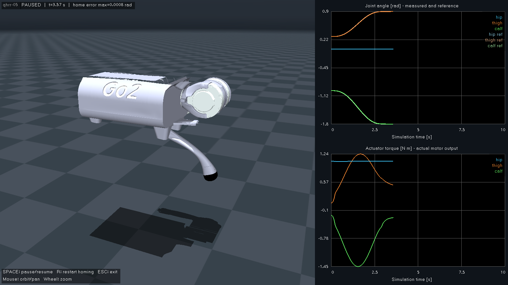

# qhrr-05

Unitree Go2의 **몸통 + FL 다리만 남긴 고정 베이스 모델**입니다. 프로젝트 소유 모델은 이 디렉터리에서 관리합니다.


## 모델 계약

- 진입점: `scene.xml`(바닥·조명 포함), `qhrr-05.xml`(로봇만).
- `nq=3`, `nv=3`, `nu=3`. 몸통 `base`는 월드에 고정되어 있으며 free joint나 weld 제약이 없습니다.
- 관절·구동기 순서: `FL_hip_joint` → `FL_thigh_joint` → `FL_calf_joint`.
- `qpos`·`qvel` 주소는 모두 `0, 1, 2`입니다. 자유 베이스의 `+7/+6` 오프셋을 사용하면 안 됩니다.
- 시간 간격은 1 ms, 몸통 원점 높이는 원본의 0.445 m를 사용합니다.
- `home` keyframe: 관절각 `[0, 0.9, -1.8] rad`, **모터 토크 `[0, 0, 0]`**.
- 모터는 토크 입력이며 위치 서보가 아닙니다. 제한은 원본의 hip/thigh `±23.7`, calf `±45.43`입니다.
- 몸통 자세·관성 파라미터와 FL의 관성·축·관절 범위·마찰·충돌 형상은 원본 값을 유지합니다. 고정 몸통의 질량·관성은 제거한 부품에 맞춰 재추정하지 않았으므로, 추후 자유 베이스로 전환할 때 재검토해야 합니다.
- IMU·머리·카메라·나머지 다리는 없습니다. `FL_foot` site는 발 충돌 구의 중심을 나타내는 기하학적 표시이며 추가 링크나 센서가 아닙니다.

| 관절 | 축 | 범위 [rad] |
| --- | --- | --- |
| `FL_hip_joint` | `(1, 0, 0)` | `[-1.0472, 1.0472]` |
| `FL_thigh_joint` | `(0, 1, 0)` | `[-1.5708, 3.4907]` |
| `FL_calf_joint` | `(0, 1, 0)` | `[-2.7227, -0.83776]` |

## 원본과 형상 변경

원본은 [MuJoCo Menagerie / unitree_go2](https://github.com/google-deepmind/mujoco_menagerie/tree/6da8b971844845de6ab27315aacc3a3fea4ddb8e/unitree_go2)이며, 사용 커밋은 `6da8b971844845de6ab27315aacc3a3fea4ddb8e`입니다. 원본 [BSD-3-Clause 라이선스](LICENSE)를 보존했습니다. 파일별 원본·로컬 SHA-256과 수정 여부는 [provenance.json](provenance.json)에 기록했습니다.

- FR/RL/RR 서브트리와 대응 모터·전용 메시를 제거했습니다.
- 몸통의 `freejoint`, IMU site, 머리 전용 `base_0/1/2` 메시와 앞쪽 cylinder/sphere 충돌 형상을 제거했습니다.
- 머리와 상단 돌출물이 `base_3/4` 메시에도 합쳐져 있어, 몸통 프레임에서 `x <= 0.1881 m`, `z <= 0.057 m` 평면으로 시각 메시를 절단하여 `torso_3/4.obj`로 저장했습니다. 교차 면을 잘라 재삼각화했고, 원본 UV·법선·외부 MTL 참조를 제거했습니다. 절단면은 막지 않은 시각용 셸입니다.
- 몸통 충돌은 원본의 box 하나만 사용합니다. 절단 메시를 충돌이나 관성 추정에 사용하지 않습니다.
- FL용 메시 7개는 원본 파일을 변경 없이 복사했습니다. 총 메시 파일은 몸통 2개를 포함해 9개입니다.
- 기존 12관절·자유 베이스 keyframe을 3관절 home과 0 토크로 바꿨습니다.

## 실행과 제어 설정

저장소 루트에서 빌드하고 데몬으로 실행합니다.

```bash
cmake -S . -B build -DCMAKE_BUILD_TYPE=Debug
cmake --build build --parallel 2
./build/daemon
```

데몬이 MuJoCo 기반 `task_controller` 창을 엽니다. 로봇은 초기 자세에서 3초 동안 호밍 목표로 이동하고, 이후 해당 자세를 계속 유지합니다. 제어와 시각화는 같은 프로세스에서 실행하며, 제어 계산은 1 ms 물리 스텝에 맞춥니다.

설정은 **[config/control_config/control_config.yaml](../../config/control_config/control_config.yaml) 하나**에서 관리합니다. 설정 변경 후 데몬을 다시 실행하면 적용됩니다.

| 설정 | 기본값 | 의미 |
| --- | --- | --- |
| `kp` | `[80, 80, 80]` | 위치 게인 [N·m/rad], 스칼라 또는 3개 값 |
| `kd` | `[4, 4, 4]` | 속도 게인 [N·m·s/rad], 스칼라 또는 3개 값 |
| `homing.initial_position_rad` | `[0, 0.3, -1.0]` | 시뮬레이션 시작 자세 |
| `homing.position_rad` | `[0, 0.9, -1.8]` | 호밍·유지 목표 자세 |
| `homing.duration_sec` | `3.0` | 호밍 이동 시간 [시뮬레이션 초] |
| `bias_compensation` | `true` | MuJoCo의 중력·코리올리 항 보상 |
| `plots.history_sec` | `10.0` | 그래프의 최근 표시 구간 [초] |
| `plots.sample_hz` | `100.0` | 그래프·CSV 수집 주기 [Hz] |

관절 순서는 항상 FL hip → thigh → calf입니다. 초기·목표 자세가 관절 한계를 벗어나거나, 게인·설정 이름·로봇·순서가 잘못되면 실행을 실패시킵니다. 이전 `robot_config/.../pd_config.yaml`은 삭제했습니다. XML `home` keyframe은 모델 자산 정보이며, 현재 실행 프로그램의 시작·목표 자세는 YAML이 결정합니다.

목표 궤적은 양 끝의 속도·가속도가 0인 5차 보간입니다. 제어식은 `tau = kp*(q_ref-q) + kd*(dq_ref-dq) + bias`이며, 계산한 토크는 원본 모델의 구동기 제한 안으로 제한합니다. 일시 정지는 물리 시간과 호밍 진행을 함께 멈춥니다.

### 화면과 조작



- 왼쪽: 로봇과 `HOMING / HOLD / PAUSED` 상태, 호밍 목표와의 최대 오차.
- 오른쪽 위: 3관절의 실제 각도와 보간 목표 각도 [rad].
- 오른쪽 아래: MuJoCo `actuator_force`의 실제 모터 출력 토크 [N·m]. 목표 토크나 구속력으로 대체하지 않습니다.
- `Space`: 일시 정지·재개, `R`: 초기 자세에서 호밍 다시 시작, `Esc` 또는 창 닫기: 종료.
- 마우스 왼쪽 드래그: 회전, 오른쪽 드래그: 이동, 휠: 확대·축소.

데몬은 현재 작업 디렉터리와 무관하게 자식 실행 파일과 설정을 찾습니다. `Ctrl+C` 또는 창 닫기로 자식을 회수하며, 이름이 같은 다른 프로그램을 종료하지 않습니다. GUI·설정 오류를 명시적으로 보고하고, 화면 없는 실행으로 자동 전환하지 않습니다.

### CSV와 자동 검사

필요하면 다음처럼 직접 기록을 켤 수 있습니다. 기존 CSV는 덮어쓰지 않고 오류로 처리합니다.

```bash
./build/daemon --csv /tmp/qhrr05-new-run.csv
```

CSV에는 실행 구간 `run_id`, 시뮬레이션 시간, 실제·목표 관절각, 실제 모터 토크가 들어갑니다. `R`을 누르면 `run_id`가 증가합니다. 이번 호밍 경로에는 SHM을 사용하지 않으며, 이전 `shm_logger`·조이스틱 도구는 기본 실행에 포함되지 않습니다.

자동 검사는 다음 명령으로 실행합니다. `--headless`는 사용자가 명시적으로 선택하는 검사 모드이며 같은 모델·제어 코드를 사용합니다.

```bash
ctest --test-dir build --output-on-failure
./build/daemon --headless --duration 7 --csv /tmp/qhrr05-headless-new-run.csv
```

CTest는 모델·장면, 기본 및 변경된 호밍 목표 수렴, 설정 오류, 임의 작업 디렉터리에서 데몬 실행, exec 실패·자식 회수·다른 프로세스 보존을 확인합니다. 기본 목표는 7초 검사에서 최대 위치 오차 약 `9.91e-7 rad`, 변경 목표는 약 `1.06e-5 rad`였습니다. 이는 현재 시뮬레이션 모델·게인·보상 조건의 결과입니다.

Xvfb·xdotool·Pillow가 있는 환경에서는 `xvfb-run -a -s '-screen 0 1800x1000x24' python3 tests/gui_smoke.py`로 실제 데몬 GUI·그래프·일시 정지·재시작·종료를 검사할 수 있습니다. 해당 GUI 검사를 통과했고 위 화면을 저장했습니다. 실물 하드웨어와 강제 실시간성은 검증 범위에 포함하지 않습니다.
