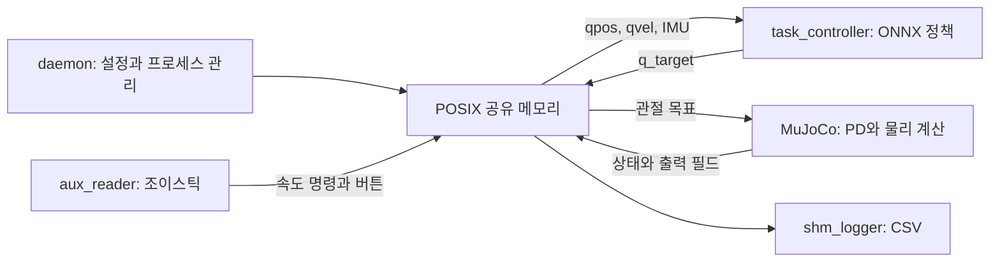

# Starting Point: 3자유도 로봇 다리 제어 시연 검증 프로그램

작성일: 2026-10-24 (Asia/Seoul)

> **이 문서는 개조 전 1차 검토 기록입니다.** 이후 로봇 자산을 고정 베이스 `qhrr-05`로 교체하고 이전 로봇·정책 설정·RL 제어 코드를 삭제했습니다. 아래 구조·수치·문제 목록은 검토 당시 기준이며, 최신 상태는 [WORK_NOTE.md](WORK_NOTE.md)와 [qhrr-05 설명](models/qhrr-05/README.md)을 확인해 주십시오.

## 1. 목적과 검토 결론

이 문서는 기존 프로젝트를 **3자유도 로봇 다리 플랫폼의 제어 시연과 정량 검증을 실행하는 프로그램**으로 개조하기 위한 기준 문서입니다. 현재 구현, 직접 확인한 문제, 제안 설계를 구분합니다. 문서 작성 단계에서는 실행 코드와 설정을 변경하지 않았습니다.

현재 프로젝트는 C++17 기반의 MuJoCo–ONNX 정책 실행 환경입니다. `daemon`이 시뮬레이터·조이스틱·정책 제어기를 실행하고, POSIX 공유 메모리로 상태와 관절 목표를 교환합니다. 단일 다리용 `qhrr` 모델과 3관절 정책이 이미 포함되어 있으므로 재사용할 수 있습니다.

다만 현재 구성에는 실험 시나리오 실행, 합격·불합격 판정, 일관된 상태·명령 교환, 명령 만료와 고장 처리가 충분히 구현되어 있지 않습니다. 우선 **정확한 3관절 상태·명령 계약과 신뢰할 수 있는 기록**을 확보하고, 반복 가능한 시뮬레이션 검증을 만든 뒤 실물 연결을 확장하는 순서를 제안합니다.

### 범위와 아직 확정하지 않은 사항

- 목표의 “3자유도”는 우선 **능동 관절 3개인 단일 다리**로 해석합니다. 고정식 시험대인지, 베이스가 움직이는 플랫폼인지는 미정입니다.
- 실물 구동기·통신 규격·제어 모드·주기·감속비·원점·허용 한계는 저장소만으로 확인할 수 없습니다.
- 기존 RL 정책을 시연에 계속 사용할지는 미정입니다. 기존 ONNX 경로는 재사용 후보이며, 검증의 유일한 제어기로 전제하지 않습니다.
- 이 문서의 관절 범위·게인·토크 범위는 **기존 시뮬레이션 설정값**입니다. 실물 운용 기준으로 승인된 값이 아닙니다.

## 2. 검토 범위와 확인 방법

직접 검토한 범위는 `CMakeLists.txt`, `app/`의 전체 소스, `include/`의 전체 헤더, 모든 프로젝트 YAML, VS Code 설정, 정책 파일 목록과 ONNX 입출력, 선택 가능한 4개 로봇 모델과 환경, MuJoCo `simulate/main.cc`의 프로젝트 연동 및 물리 실행 흐름입니다. MuJoCo 헤더에서 힘·제어 필드의 의미도 확인했습니다.

`third_party/`의 범용 예제·렌더링 코드·외부 라이브러리 전체를 줄 단위로 감사한 것은 아닙니다. 프로젝트에서 연결되는 부분과 의존성·라이선스 파일을 중심으로 구조를 확인했습니다. 외부 바이너리 자체의 보안·정확성 감사는 수행하지 않았습니다.

현재 작업 사본에서는 `git status`와 `git log`가 `not a git repository`로 실패했습니다. 따라서 커밋 기준선·브랜치·기존 변경 내역을 확인하지 못했습니다. 아래 평가는 현재 파일 내용에 대한 평가입니다.

### 수행한 검증

| 항목 | 결과 | 해석 범위 |
| --- | --- | --- |
| CMake Debug 구성 | 성공 | 현재 Linux x86_64 환경에서 의존성을 찾았습니다. |
| 전체 빌드 | 실행 파일 5개 모두 성공 | GCC 11.4.0을 사용했습니다. |
| 컴파일 경고 | `ResolvePolicyConfigDir()` 반환 경로 누락 1건 | 기본 빌드 출력 기준이며, 강화된 경고 옵션으로 전수 검사한 결과는 아닙니다. |
| YAML 파싱 | 모든 프로젝트 YAML 성공 | 키·범위·상호 일치까지 검증한 것은 아닙니다. |
| MuJoCo 모델 로드 | 설정에 등록된 환경 모델 4개 모두 성공 | 저장소에 포함된 MuJoCo 3.3.2로 직접 로드했습니다. |
| ONNX 구조 검사 | 포함된 모델 2개 모두 성공 | Python `onnx` 1.18.0을 사용했습니다. |
| ONNX 간단 추론 | 두 모델 모두 기대 출력 크기, 유한한 값 반환 | Python ONNX Runtime 1.22.0 CPU에서 0 입력을 사용했습니다. 제어 성능을 검증하지는 않습니다. |
| GUI·조이스틱·전체 프로세스 연동 | 미실행 | 현재 종료 코드의 이름 기반 전역 프로세스 종료 영향을 피하기 위해 데몬을 실행하지 않았습니다. |
| 실물·실시간성·추종 성능 | 미검증 | 실물 통신 계층과 정량 검증 절차가 없습니다. |

빌드 확인 명령은 다음과 같습니다. 외부 빌드 디렉터리를 사용하면 컴파일 결과를 소스와 분리할 수 있습니다. 다만 현재 실행 경로는 작업 디렉터리에 의존하므로 이 디렉터리에서 데몬이 그대로 실행된다는 의미는 아닙니다.

```bash
cmake -S . -B /tmp/roboworld-review-build -DCMAKE_BUILD_TYPE=Debug
cmake --build /tmp/roboworld-review-build --parallel 2
```

## 3. 현재 전체 구조

```text
.
├── CMakeLists.txt                  # QHRR0 프로젝트, 실행 파일 5개
├── app/
│   ├── daemon/                     # 설정 로드, SHM 생성, 자식 프로세스 실행·종료
│   ├── task_controller/            # 정책 세션, 관측 생성, ONNX/RNN 추론
│   ├── aux_reader/                 # Linux 조이스틱 입력
│   └── shm_logger/                 # SHM 상태의 CSV 기록
├── include/
│   ├── shared_memory.hpp          # 모든 프로세스가 공유하는 데이터 배치
│   ├── shm_utils.hpp              # shm_open/mmap/ftruncate/munmap
│   ├── task_controller.hpp
│   ├── onnx_runner.hpp
│   ├── rnn_onnx_runner.hpp
│   ├── joystick.hpp
│   └── daemon/daemon.hpp
├── config/
│   ├── app_config/daemon_config.yaml
│   └── policy_config/             # qhrr, qhrr1, rbq, SPARQ
├── policy/
│   ├── qhrr/qhrr/policy.onnx
│   └── SPARQ/SPARQ/               # policy.onnx + policy.onnx.data
├── third_party/
│   ├── mujoco/                    # 3.3.2, 모델·라이브러리·수정된 simulate
│   └── onnxruntime/               # 1.22.0, 헤더·공유 라이브러리
└── .vscode/                       # 에디터용 include 경로·파일 연결
```

루트 README, 자체 테스트 디렉터리, CTest 등록, CI 설정, 실험 결과 분석 도구, 하드웨어 드라이버는 현재 작업 사본에서 발견되지 않았습니다. 간단한 프로젝트 소개는 `third_party/mujoco/README.md`에 있습니다. 이 위치 때문에 `third_party` 전체를 변경 없는 외부 코드로 취급해서는 안 됩니다.

### 빌드와 의존성

- 언어·빌드: C++17, CMake 3.16 이상.
- 시스템 의존성: yaml-cpp, Eigen3, pkg-config, GLFW3, OpenGL, pthread 및 Linux/POSIX API.
- 포함된 런타임: MuJoCo 3.3.2, ONNX Runtime 1.22.0의 `.so`와 헤더.
- 실행 파일별 라이브러리 연결과 RPATH가 `CMakeLists.txt`에 설정되어 있습니다.
- `yaml-cpp`, Eigen, GLFW가 전역 필수 항목이므로 제어기만 빌드하려 해도 현재는 GUI 의존성 탐색이 수행됩니다.
- 설치·배포 규칙, 선택적 백엔드 빌드 옵션, 의존성 무결성 기록은 없습니다. 현재 제공 바이너리를 다른 CPU·운영체제에서 사용할 수 있는지는 별도 확인이 필요합니다.

### 프로세스별 책임

| 실행 파일 | 현재 역할 | 주요 파일 |
| --- | --- | --- |
| `daemon` | 로봇 선택, YAML 로드, SHM 생성, 프로세스 실행·종료 | [main.cpp](app/daemon/main.cpp), [daemon.cpp](app/daemon/daemon.cpp) |
| `mujoco_simulate` | GUI·물리 시뮬레이션, 관절 PD, 상태 발행 | [simulate/main.cc](third_party/mujoco/simulate/main.cc) |
| `task_controller` | 50 Hz로 상태를 읽고 ONNX 정책의 관절 목표를 기록 | `task_controller.cpp` (이후 삭제) |
| `aux_reader` | `/dev/input/js0`의 축·버튼을 SHM에 반영 | [joystick.cpp](app/aux_reader/joystick.cpp) |
| `shm_logger` | 50 Hz로 상태·출력 일부를 CSV에 기록 | [main.cpp](app/shm_logger/main.cpp) |

기본 설정은 시뮬레이터 → 조이스틱 → 제어기 순서로 새 GNOME Terminal에서 실행합니다. 로거는 주석 처리되어 있습니다. 시작 준비 완료 대신 고정 지연을 사용합니다.

### 데이터와 제어 흐름



1. 데몬이 기본 `/shm0`을 만들고 선택한 로봇의 모델·정책 디렉터리를 자식에게 전달합니다.
2. 시뮬레이터는 `qpos`, `qvel`, 자세·각속도 센서, 시뮬레이션 시간을 발행합니다.
3. 제어기는 관측을 조립하고 정책을 실행합니다. `qhrr`에서는 정책 출력에 스케일을 적용한 뒤 기본 관절각을 더해 `q_target`을 만듭니다.
4. PD 계산은 제어기 밖인 시뮬레이터에 있습니다. 현재 식은 `u = kp * (q_target - q) - kd * qd`입니다.
5. `u`를 `data->ctrl`에 기록하고 물리를 진행합니다. `qhrr` 모델에는 모터 `ctrlrange`가 있지만, 제어 명령의 관절 위치·속도·변화율을 검증하는 공통 계층은 없습니다.

제어기 50 Hz는 벽시계 기준입니다. `qhrr` 물리 시간 간격은 1 ms이지만, 상태 발행은 매 물리 스텝마다 이루어지는 구조가 아닙니다. GUI 물리 루프에서 여러 스텝을 진행한 뒤 발행할 수 있으며, 일시 정지 중에도 상태를 발행합니다. 따라서 `state_seq` 증가가 물리 시간 진행을 보장하지 않습니다.

## 4. 3자유도 플랫폼과 직접 관련된 자산

### qhrr 단일 다리 모델

검토 당시 연결된 파일은 `third_party/mujoco/model/one_leg_v2/qhrr0_environment.xml`이며, `qhrr0.xml`과 지형·장애물 환경을 포함했습니다. 이 이전 모델은 이후 삭제되었습니다.

| 순서 | 관절명 | XML 축 | 기존 관절 범위 [rad] | 기본 목표 [rad] |
| --- | --- | --- | --- | --- |
| 0 | `RL_hip_roll` | `(1, 0, 0)` | `[-1.44, 1.44]` | `0.0` |
| 1 | `RL_hip_pitch` | `(0, -1, 0)` | `[-2.68, 3.28]` | `-1.1` |
| 2 | `RL_knee_pitch` | `(0, -1, 0)` | `[0.29, 2.79]` | `2.3` |

- 능동 관절은 3개지만 베이스에는 `freejoint`가 있습니다. 현재 모델은 고정식 3자유도 시험대와 동일하지 않습니다.
- 다리 모델 단독의 구성으로는 `nq=10`, `nv=9`가 예상되지만, **현재 선택되는 전체 환경**은 가동 장애물 때문에 `nq=87`, `nv=75`, `nu=3`입니다. 전체 환경 수치는 MuJoCo 로드로 확인했습니다.
- 모터 3개의 `ctrlrange`는 모두 `[-160, 160]`입니다. 실물의 허용 토크로 가져오면 안 됩니다.
- PD 설정은 `kp=20`, `kd=1`, `num_joint=3`입니다. YAML의 `decimation: 1`은 현재 코드에서 읽지 않습니다.
- 기본 자세와 정책 입력·출력의 관절 변환은 `[0, 1, 2]`로 동일합니다.
- `base_link_imu`와 `RL_hip` 내부 `imu`가 따로 있습니다. 시뮬레이터의 상태 추출은 `imu_quat`·`imu_gyro`를 사용하므로, SHM의 자세·각속도는 이름과 달리 베이스 자체의 센서와 다를 수 있습니다. 정책 학습 때 기대한 센서 부착 위치와 좌표계를 확인해야 합니다.
- `qhrr0 copy.xml`은 현재 데몬 설정의 실행 경로에 포함되지 않습니다. 삭제·이름 변경 전 용도를 확인해야 합니다.

### 정책·모델 정합성

| 로봇 프로필 | 환경 `nq / nv / nu` | 정책 파일 | 확인한 ONNX 입력 → 출력 |
| --- | --- | --- | --- |
| `qhrr` | `87 / 75 / 3` | 포함됨 | `obs [1,24] → actions [1,3]` |
| `qhrr1` | `96 / 84 / 12` | 설정 경로에 없음 | 미확인 |
| `rbq` | `96 / 84 / 12` | 설정 경로에 없음 | 미확인 |
| `SPARQ` | `96 / 84 / 12` | 포함됨, 외부 가중치 파일 동반 | `obs [1,70] → actions [1,12]` |

`rbq_recovery` 정책 파일도 없으며, 현재 정책 목록에서는 비활성 상태입니다. 로봇 선택 항목이 있다고 해서 해당 프로필을 바로 실행할 수 있는 것은 아닙니다.

`qhrr` 관측 구성은 각속도 3 + 투영 중력 3 + 명령 3 + 관절 위치 편차 3 + 관절 속도 3 + 과거 행동 9 = 24차원입니다. YAML 구성과 ONNX 입력 크기는 일치합니다. 정책 출력은 `±100`으로 클립한 뒤 `0.25`를 곱하므로 최대 `±25 rad`의 오프셋이 될 수 있습니다. 이는 관절 가동 범위에 맞춘 명령 제한이 아닙니다.

## 5. 확인한 문제와 개선 우선순위

P0는 검증 결과의 신뢰성 또는 출력 제어에 직접 영향을 주어 먼저 처리할 항목입니다. P1은 반복 가능한 실행을 위한 항목이며, P2는 확장·정리 항목입니다. 아래 항목은 별도로 명시한 경우를 제외하고 코드에서 확인한 사실입니다.

### P0: 상태·명령·기록의 정확성

| 항목 | 현재 근거와 영향 | 개선 방향 |
| --- | --- | --- |
| 기록되는 출력의 의미가 틀립니다. | [simulate/main.cc:316](third_party/mujoco/simulate/main.cc)은 `ctrl_applied`에 `qfrc_constraint`의 앞 `nu`개를 복사합니다. 이는 실제 제어 입력이나 구동기 출력이 아닌 일반화 좌표의 구속력입니다. 자유 베이스에서는 앞 성분이 다리 관절과도 대응하지 않습니다. | `ctrl_command`, `actuator_force`, `joint_torque`, `constraint_force`를 의미·차원·관절 매핑에 맞게 분리합니다. 관련 필드 정의는 [mjdata.h](third_party/mujoco/include/mujoco/mjdata.h)에 있습니다. |
| SHM 스냅샷 일관성이 보장되지 않습니다. | [shared_memory.hpp](include/shared_memory.hpp)의 일반 필드를 프로세스들이 동기화 없이 읽고 씁니다. 상태 작성 끝에서만 `state_seq`를 증가시키므로 로거의 전후 번호 비교로 작성 중인 데이터를 배제할 수 없습니다. 재시도 3회 실패 후에도 기록합니다. | 플랫폼에서 검증한 프로세스 간 동기화와 발행 규약을 구현하고, 읽기 실패·시간 초과를 명시적으로 처리합니다. 카운터만 atomic으로 바꾸는 것으로 페이로드 동시 접근이 해결되지는 않습니다. |
| 명령 번호와 신선도 검사가 작동하지 않습니다. | 제어기는 `task_controller.cpp:400` (이후 삭제)에서 목표만 쓰고 `command_seq`를 갱신하지 않습니다. 시뮬레이터는 이 번호를 적용 번호로 복사합니다. 명령·상태 만료 시간과 heartbeat가 없습니다. | 명령 발행 시 번호·기준 상태 번호·생성 시각·유효 기간을 함께 발행합니다. 백엔드에서 기한 만료를 감지하고 고장 상태로 전환합니다. |
| 환경 상태가 조용히 잘립니다. | SHM의 `qpos/qvel` 한도는 각각 64입니다. 실제 모든 환경 모델이 이를 초과하지만 [simulate/main.cc:294](third_party/mujoco/simulate/main.cc)에서 차원을 잘라 발행합니다. 현재 `qhrr`의 앞쪽 3관절 값은 남지만, 발행 차원은 원본 모델 차원을 나타내지 않습니다. | 검증용 최소 환경을 만들고, IPC에는 선택한 3관절 상태를 명시적으로 전달합니다. 지원 한도 초과는 시작 오류로 처리합니다. 전체 모델 상태가 필요하면 별도 명세를 둡니다. |
| 고정 오프셋과 크기 검증 누락이 있습니다. | `task_controller.cpp:350` (이후 삭제)은 `qpos[7+i]`, `qvel[6+i]`를 사용합니다. `nu`·정책 관절 수·기본각·변환 배열 길이의 일치를 검증하지 않습니다. 현재 자유 베이스 모델에는 맞지만 고정식 모델로 바꾸면 잘못된 상태를 읽습니다. | 관절명으로 주소를 찾고 초기화 시 일대일 대응과 길이·인덱스 범위를 검증합니다. 컨트롤러에는 정규화한 3관절 상태를 전달합니다. |
| 자동 제어 진입과 무효 명령 처리 규약이 없습니다. | `task_controller.cpp:185` (이후 삭제)에서 곧바로 `TASK_RL`로 진입합니다. 시뮬레이터는 유효 명령 수신 전에도 0으로 초기화된 목표에 PD를 적용할 수 있습니다. 관절·속도·변화율 검사와 정지 상태 관리가 없습니다. | 명시적 준비 완료·운용 시작·고장·정지 상태를 구현합니다. 명령의 유한값과 한계를 검사하고, 정지 동작은 베이스 지지 방식과 구동기 사양에 따라 정의합니다. |
| 로거가 12관절 형식으로 고정되어 있습니다. | [shm_logger/main.cpp:79](app/shm_logger/main.cpp)은 `nq=19`, `nv=18`, `nu=12`를 고정합니다. `qhrr`에서는 다른 물체 상태나 유효하지 않은 구동기 채널까지 로봇 데이터처럼 기록할 수 있습니다. `q_target`과 판정 결과는 기록하지 않습니다. | 3관절 계약으로 헤더와 데이터를 생성하고, 상태·명령·실제 출력·모드·오류·판정 근거를 같은 실험 ID로 남깁니다. |

### P1: 실행 실패와 재현성

| 항목 | 현재 근거와 영향 | 개선 방향 |
| --- | --- | --- |
| 프로세스 종료 범위가 넓습니다. | [daemon.cpp:166](app/daemon/daemon.cpp)의 `Signal()`과 `TerminateAll()`은 저장한 PID/PGID 대신 `pkill -x`로 이름을 검색합니다. 다른 실행 인스턴스나 동일 이름 프로세스를 종료할 수 있습니다. | 이번 실행에서 소유한 PID/PGID만 추적·종료하고 `waitpid`로 회수합니다. 터미널 래퍼와 실제 자식의 관계도 정리합니다. |
| 자식 실행 성공·생존 상태를 감시하지 않습니다. | `Spawn()`은 fork 성공을 반환하고 자식의 exec 실패는 부모에 전달하지 않습니다. 데몬 주 루프는 `Reap()`·`RefreshRunning()`을 호출하지 않으며, 실행 실패 후에도 나머지 시작을 계속합니다. | exec 결과 전달, 준비 완료 handshake, 기한 있는 시작 절차, 필수 프로세스 사망 시 실험 실패와 종료를 구현합니다. 자동 재시작은 별도 명시 정책으로 둡니다. |
| 설정과 환경변수 적용이 어긋납니다. | [daemon_config.yaml](config/app_config/daemon_config.yaml)의 최상위 `env`는 로드되지 않습니다. `shm.name`도 자식 `SHM_NAME`에 연결되지 않으므로 이름을 바꾸면 프로세스가 분리될 수 있습니다. `size_bytes`는 읽지만 실제 SHM 생성 크기에는 쓰이지 않습니다. | 하나의 검증된 실행 설정에서 모든 자식 인자를 생성하고, 사용하지 않는 설정 키는 거부하거나 제거합니다. |
| 경로가 현재 작업 디렉터리에 의존합니다. | 실행 파일은 `./...`, 모델·정책은 `../...`를 사용합니다. 기본 설정 탐색이 루트 실행을 허용해도 내부 경로는 자동 보정되지 않습니다. 사용하지 않는 `ResolvePolicyConfigDir()`에는 반환 누락 경고가 있습니다. | 설정 파일 또는 명시적 자산 루트를 기준으로 경로를 확정하고 실제 선택 경로를 기록합니다. 사용하지 않는 탐색 함수를 제거합니다. |
| PD 설정 오류가 다른 설정이나 기본값으로 가려집니다. | [simulate/main.cc:123](third_party/mujoco/simulate/main.cc)의 `LoadPdConfig()`는 예외 원인을 버리고 다른 후보를 시도합니다. 모두 실패하면 0 게인으로 계속하며, 일부 키가 빠진 설정도 수용합니다. | 명시한 파일의 누락·파싱 실패·필수 키 누락은 오류로 종료합니다. 승인된 기본값과 선택적 항목만 출처를 표시하여 사용합니다. |
| 입력·센서 장애가 유효한 값처럼 남습니다. | 센서 추출 실패는 단위 quaternion·0 각속도로 대체되고 호출부가 실패를 처리하지 않습니다. 조이스틱 연결 해제 후 마지막 목표와 버튼은 남으며, 입력 스레드가 종료되어도 주 프로세스는 계속 대기할 수 있습니다. | 센서·입력 유효성, 마지막 수신 시각, 연결 상태를 전달하고, 필수 입력 장애를 상태 전이에 반영합니다. |
| SHM 초기화·접속 계약이 없습니다. | 기존 SHM은 버전·소유자·세션 확인 없이 재사용됩니다. `OpenShm()`은 파일 크기를 검사하지 않습니다. 새 영역을 `memset`하여 헤더의 quaternion 기본값도 0이 됩니다. 준비 전 데이터 수용을 막는 장치가 없습니다. | 생성 소유자를 하나로 정하고 magic·버전·크기·실행 ID·ready를 검증합니다. 기존 세션 연결은 명시적으로 선택하고 기록합니다. |
| 오류와 스레드 수명 관리가 불완전합니다. | `std::string(std::getenv(...))`는 null 검사 전에 문자열을 만듭니다. 제어기 `pthread_create()` 결과를 검사하지 않고, 조이스틱 `thread_`는 초기값이 없습니다. 초기화·추론 예외를 실행 결과로 정리하는 경계도 없습니다. | 입력 확인 후 변환하고, 시작 성공 여부를 추적하여 join합니다. RAII로 자원을 소유하고, 실행 경계에서 오류를 진단·정지·종료 코드로 전달합니다. |

### P2: 정책 경로와 유지보수

- **RNN 출력 인덱스:** `rnn_onnx_runner.cpp:107` (이후 삭제)은 행동 출력을 `output_tensors[num_joint_]`에서 읽습니다. 관절 수를 출력 텐서 번호로 쓰므로 일반적인 2출력 모델에서 범위를 벗어날 수 있습니다. 출력 이름·형상으로 선택해야 합니다. 현재 활성 설정은 모두 `onnx`이며 포함된 RNN 모델이 없어 실제 RNN 실행 검증은 하지 못했습니다.
- **RNN 상태 관리:** 기본 ONNX 경로와 달리 비유한값 처리·행동 이력 갱신이 없고 reset 범위도 다릅니다. RNN을 유지한다면 관측 이력과 hidden state의 수명·초기화 계약을 통일해야 합니다.
- **ONNX 입출력 계약:** 모델 입력·출력 형상과 변환 배열을 시작 시 검증하지 않습니다. 일반 ONNX 경로의 NaN 처리에는 경고가 있지만 “Resetting robot” 메시지와 달리 실제 로봇 리셋이나 고장 상태 전이는 없습니다. 0 행동 대체는 기본 자세 목표로 이어질 수 있습니다.
- **설정의 암묵적 기본값:** `runner_type` 누락 시 RNN을 선택하며 관측 설정 누락 시 기본 구성을 선택합니다. 기본 구성의 `actions` 항목은 관측 생성 함수에서 지원하지 않아 실행 중 예외가 날 수 있습니다. 설정 검증을 초기화 단계로 옮겨야 합니다.
- **루프 비용과 시간 기준:** 제어·관측·추론 경로에서 벡터 생성과 콘솔 출력을 반복합니다. 상대 sleep 기반 제어는 실행 시간 변동을 누적할 수 있고, 시뮬레이션 정지·배속과 독립적으로 정책 이력이 진행됩니다. 초기 버퍼 할당, 명시적 tick 기준, 주기 계측이 필요합니다.
- **벤더 코드와 모델 위치:** 프로젝트 로직과 모델이 `third_party/mujoco` 안에 섞여 있습니다. 자체 백엔드·모델을 외부 라이브러리와 분리하면 업그레이드와 변경 검토가 쉬워집니다. 기존 라이선스·고지와 정책 출처는 보존해야 합니다.
- **이름·죽은 코드:** `QHRR0`, `qhrr`, `qhhr` 표기, 오래된 CLI 안내, 비활성 recovery·보간 코드와 미사용 멤버를 정리할 필요가 있습니다. `KILL_ON_EXIT`는 참·거짓 값 대신 환경변수 존재 여부만 검사하며, 실제 동작은 셸 유지입니다.

## 6. 제안하는 목표 구조

### 우선 만들 최소 실행 단위

첫 실행 단위는 **3관절 모델 하나 + 명시적으로 선택한 제어기 하나 + 실험 시나리오 하나 + 기록·판정**으로 구성하는 것을 제안합니다. 기존 프로세스를 모두 재설계하기보다 공통 데이터·시간·실패 계약을 먼저 도입합니다.

1. 관절명과 베이스 지지 방식을 명시한 단순 시험 환경을 선택합니다.
2. 초기화 단계에서 모델·설정·정책·센서·한계의 일치를 검증합니다.
3. 준비 상태에서 명시적 시작 요청을 받은 뒤 목표 궤적 또는 정책을 실행합니다.
4. 백엔드가 명령의 유효성과 한계를 확인하고 출력합니다.
5. 결과 파일과 판정 근거를 남기며 정상 완료·불합격·실행 오류를 구분합니다.

### 책임 경계

| 구성 요소 | 담당할 책임 |
| --- | --- |
| 실행 관리자 | 설정 검증, 실행 ID, 소유 프로세스 관리, 준비·종료 절차 |
| 시나리오 실행기 | 초기 조건, 제어기 선택, 궤적·외란·시험 시간, 평가 구간 |
| 제어기 | 검증된 상태와 목표를 받아 명시적 의미의 명령 생성 |
| 백엔드 | 모델·장치 주소 변환, 입출력, 명령 만료 감시, 한계 적용, 상태 발행 |
| 기록·평가 | 시계·명령·상태·오류 기록, 지표 계산, 합격·불합격 판정 |

시뮬레이션·실물 백엔드는 같은 의미의 3관절 인터페이스를 사용하도록 제안합니다. 단, 실물 백엔드는 장치 사양이 정해진 이후 구현하며, 실물 연결 실패 시 시뮬레이터로 자동 전환하지 않습니다.

### 3관절 데이터 계약

- 관절 순서: 이름으로 확정한 3개 관절. 동적 모델 주소와 제어기 배열 인덱스를 분리합니다.
- 상태: `q[3]`, `dq[3]`, 지원되는 경우 토크·전류 등 측정값, 센서 유효성, 상태 번호, 측정 시각, 고장 코드.
- 명령: 제어 모드, 목표 위치·속도·토크 중 해당 모드의 필수 필드, 명령 번호, 기준 상태 번호, 생성 시각·만료 시각.
- 단위: 관절각 rad, 각속도 rad/s, 관절 토크 N·m, 길이 m, 시간 단위를 필드명·명세로 고정합니다.
- 좌표: 관절 양의 방향·영점·기어비·모터/관절 변환, IMU 부착 프레임, quaternion `wxyz`를 명시합니다.
- 시간: 시뮬레이션 시간·장치 측정 시간·호스트 monotonic 시간을 구분합니다. 벽시계는 실행 식별에 사용하고 제어 기한 판정에는 monotonic 시간을 사용합니다.
- 측정할 수 없는 물리량은 유효성 정보와 함께 표시합니다. 명령 토크를 측정 토크로 기록하지 않습니다.
- 3관절 계산 버퍼는 `std::array<double, 3>` 등 고정 크기를 우선합니다. ONNX 경계의 벡터·텐서는 초기화 때 크기를 확정합니다.

### 실행 상태와 실패 처리

기본 전이는 `BOOT → VALIDATING → READY → RUNNING → STOPPING → STOPPED`를 제안합니다. 모든 운용 상태에서 `FAULT`로 전이할 수 있어야 하며, 실물에서는 비상정지 상태를 별도로 연동합니다. fault를 해제하거나 실험을 재시작할 때에는 명시적 요청과 준비 조건 재검증이 필요합니다.

상태 전이 이유, 오류 코드, 마지막 유효 상태·명령 번호를 기록합니다. 무효 입력은 일반 데이터로 대체하여 제어를 지속하지 않습니다. 정지 시 감속·자세 유지·토크 차단 중 어느 동작을 사용할지는 기구 지지 조건과 장치 사양에 맞춰 정해야 합니다. 무조건 0 토크나 기본 자세로 이동하는 방식을 안전한 동작으로 간주하지 않습니다.

### 디렉터리 정리 방향

즉시 전면 이동하기보다 테스트를 확보한 뒤 단계적으로 다음 경계를 만드는 것을 제안합니다.

```text
app/                    # 실행 진입점과 오케스트레이션
include/leg_demo/        # 상태·명령·설정·백엔드 계약
src/
  controllers/          # 궤적/PD/ONNX 제어기
  backends/             # MuJoCo 및 추후 실물 I/O
  validation/           # 시나리오, 지표, 판정
  ipc/                  # SHM 수명과 동기화
config/                 # 로봇, 제어기, 시나리오 설정
models/leg3/            # 프로젝트 소유 MJCF와 메시
policy/                 # 선택적 ONNX 자산과 메타데이터
tests/                  # 계약·고장·통합 검증
tools/                  # 결과 분석과 실행 보조 도구
third_party/            # 외부 의존성과 라이선스
```

GUI와 ONNX는 선택 빌드로 만들고, 화면 없는 시나리오 실행이 GUI 없이 빌드·실행되도록 제안합니다. 배치 검증에서는 물리 tick을 기준으로 정책 실행 간격을 고정하여 같은 조건을 재현하고, 실제 시간 시연에서는 별도로 지연·deadline miss를 측정합니다.

## 7. 코드 작성 원칙

다음은 개조 작업에 적용할 제안 원칙입니다. 현재 코드가 모두 충족한다는 의미는 아닙니다.

1. **조용한 대체 동작을 금지합니다.** 명시된 설정·모델·정책·장치·센서가 없거나 잘못되면 이유를 표시하고 시작을 실패시킵니다. 다른 파일·모델·백엔드로 자동 전환하지 않습니다. 선택적 기능을 끄거나 승인된 기본값을 쓰는 경우에도 적용값과 출처를 기록합니다.
2. **계약을 초기화 시 검증합니다.** 관절 수·이름·순서, 배열 길이와 변환 인덱스, ONNX dtype·shape, 주기·게인·한계의 유한값과 범위, 지원 설정 키를 검증합니다. `nq=nu+7` 같은 레이아웃 가정을 제어기에 넣지 않습니다.
3. **출력 직전에 다시 검증합니다.** 시뮬레이터와 장치 백엔드 모두 명령 유효성·만료·모드·한계를 검사합니다. 상태 소실이나 NaN을 정상 목표로 바꾸지 않습니다. 제한 적용이 허용된 경우에도 적용 전후 값과 포화 여부를 남깁니다.
4. **각 데이터의 작성자를 하나로 정합니다.** 센서 상태는 백엔드, 제어 명령은 제어기, 운용 요청은 입력 계층이 작성합니다. SHM 영역별 소유권과 동기화·메모리 가시성·실패 시 처리 규약을 문서화하고 검증합니다.
5. **제어 계산과 I/O를 분리합니다.** 제어 법칙은 가능한 한 입력 상태와 목표에서 명령을 계산하는 함수로 만듭니다. 파일·YAML·GUI·장치·종료 처리는 루프 밖이나 경계 계층에 둡니다.
6. **주기 경로의 비용을 관리합니다.** 초기화 후 버퍼를 재사용하고, 파일 쓰기·매 tick 콘솔 출력·예측하기 어려운 대기를 피합니다. 절대 기한 기반 실행과 주기 계측을 사용하며, 실시간성 확보 여부는 측정 결과로 판단합니다.
7. **오류를 호출자에게 전달합니다.** 초기화·스레드·장치 작업은 성공 여부와 원인을 반환하거나 정의된 예외 경계로 전달합니다. `main`과 작업 스레드 경계에서 실패를 기록·정리하고 종료 상태에 반영합니다. 무기한 재시도 대신 기한과 원인을 둡니다.
8. **자원 수명을 명시합니다.** SHM 매핑·FD·스레드·ONNX 세션은 RAII로 관리하고, 복사 가능 여부와 소유권을 정합니다. 종료는 반복 호출해도 안전해야 하며 소유하지 않은 프로세스나 세션을 건드리지 않습니다.
9. **형식과 빌드 규칙을 도구로 고정합니다.** C++17을 유지하고, 자체 코드에는 `enum class`, 명확한 초기값, const 정확성을 적용합니다. clang-format과 `-Wall -Wextra -Wpedantic`을 도입하되 외부 코드 경고 정책은 분리합니다. 헤더 자체 포함 가능성도 확인합니다.
10. **동작 계약을 검증합니다.** 수식 복제 테스트보다 관절 순서 오류, 잘못된 형상, 명령 만료, 입력 단절, 포화, 프로세스 사망, 기록 의미처럼 실제 실패를 드러내는 테스트를 우선합니다. 의미 있는 변경 뒤 필요한 검증을 실행합니다.
11. **실험 자산을 식별 가능하게 보존합니다.** 설정·정책·모델의 버전 또는 해시, 난수 seed, 실행 인자를 기록합니다. 실행별 결과 디렉터리를 사용하고 기존 로그를 묵시적으로 덮어쓰지 않습니다.

## 8. 검증 프로그램이 제공해야 할 시나리오와 결과

우선은 관절 공간의 반복 가능한 시험을 구현하고, 플랫폼 목적이 확정된 후 발끝 제어·접촉 실험을 추가하는 것을 제안합니다.

| 시나리오 | 확인할 내용 | 기록·판정 예시 |
| --- | --- | --- |
| 사전 점검 | 관절·센서·모델·정책·설정 일치 | 누락·순서·형상·한계 오류 시 시작 실패 |
| 준비 및 자세 전환 | 목표 불연속 방지, 제한된 속도·가속도 | 최대 위치 오차, 전환 시간, 포화 여부 |
| 관절별 step·sine | 각 관절의 추종과 관절 간 영향 | 관절별 RMSE·최대 오차·overshoot·정착 시간 |
| 3관절 동시 궤적 | 결합된 움직임과 반복성 | 동일 조건 반복의 편차, 토크·속도 한계 |
| ONNX 정책 시연 | 관측·스케일·프레임과 출력 유효성 | 행동·목표·실제 상태, 유한값, 연속성 |
| 장애 주입 | 오래된 명령·센서 소실·입력 단절·프로세스 사망 | 감지 시간, 상태 전이, 출력 처리, 오류 기록 |
| 중단·재시작 | 소유 자원 정리와 오래된 데이터 차단 | 잔여 프로세스, 세션 혼동, 명시적 재시작 |

합격 기준은 시나리오 설정에 시험 시간·평가 구간·단위와 함께 둡니다. RMSE·정착 시간·최대 토크 등의 허용 수치는 플랫폼 사양과 요구 성능을 바탕으로 확정해야 합니다. 현재 문서에서 임의의 수치를 합격 기준으로 정하지 않습니다.

실행별로 다음 산출물을 제안합니다.

- 실행 메타데이터: 실행 ID, 시작 시각, 사용 백엔드, 소스 버전 확인 가능 여부, 모델·정책·설정 해시, 주기, seed.
- 시계열: 상태·명령 번호, 측정·발행·적용 시각, 관절 목표·실제값, 명확히 구분한 제어 입력·측정 출력, 유효성·포화·오류.
- 결과 요약: 성공/불합격/실행 오류, 지표·기준·단위·평가 구간, fault 원인, 누락 샘플·로그 오류 여부.
- 프로세스 결과: 정상 완료·불합격·실행 오류를 자동화에서 구분할 수 있는 종료 코드 계약.

기존 50 Hz CSV만으로 1 ms 물리 스텝의 최대 토크나 지연을 판정해서는 안 됩니다. 필요한 고속 지표는 tick에서 집계하거나 충분한 주기로 수집하고, GUI 표시·저장 주기와 분리합니다. 로깅 쓰기 실패와 버퍼 초과도 결과에 반영해야 합니다.

## 9. 단계별 실행 계획과 완료 조건

| 단계 | 작업 | 완료 조건 |
| --- | --- | --- |
| 0. 기준선 확보 | 소스 버전 관리 상태 확인, 빌드·실행 절차 문서화, 기존 qhrr 자산 식별 | 다른 작업자가 같은 의존성으로 빌드하고 자산을 찾을 수 있습니다. |
| 1. 정확성 복구 | 출력 필드 수정, 3관절 매핑·차원 검사, 명시적 경로·설정, 소유 PID 종료 | 잘못된 입력은 구동 전 실패하며, 기록값 의미가 모델 출력과 일치하고 다른 실행에 영향을 주지 않습니다. |
| 2. 실행 계약 확보 | SHM 동기화·버전·세션·ready, 명령 번호·기한, 상태 전이·입력 장애 처리 | 오래된/불일치/부분 데이터와 자식 사망을 검출하고 이유를 기록합니다. |
| 3. 최소 검증 실행 | 단순 환경, 궤적 제어기, 화면 없는 시나리오 실행, 로그·판정 | 3관절 시나리오를 반복 실행하고 설정된 기준으로 결과를 판정합니다. |
| 4. 시연 통합 | ONNX 선택 경로, GUI·조이스틱 운용, 명시적 시작·중단 | 같은 상태·명령·오류 계약으로 시연과 결과 저장을 수행합니다. |
| 5. 실물 확장 | 장치 사양 확인 후 백엔드·영점·한계·비상정지 연동 | 시뮬레이션 검증 후 장치별 절차로 통신·방향·제한·정지를 확인합니다. |

실물 운용이 다음 단계의 필수 목표라면 단계 1~3과 병행하여 장치 사양을 확보해야 합니다. 구현 순서는 시험대 지지 조건과 제어 모드에 따라 조정할 수 있습니다.

## 10. 다음 구현 전 확정할 결정

| 결정 | 필요한 정보 | 영향을 받는 부분 |
| --- | --- | --- |
| 베이스 지지 방식 | 고정 시험대, 가이드, 자유 베이스 중 실제 구성 | 모델, 자세 상태, 정지 동작, 시험 항목 |
| 시연 제어 방식 | 관절 궤적/PD, 발끝 제어, RL 중 필수 범위 | 제어기, 목표 입력, 정책 유지 여부 |
| 실물 연결 범위 | 모터·드라이버, CAN/EtherCAT/기타, SDK·프로토콜 | 백엔드, 상태·명령 모드, 주기 |
| 관절·센서 기준 | 실제 관절명·방향·영점·감속비·센서 프레임 | 주소 변환, 관측, 한계, 기록 단위 |
| 운용 한계와 정지 | 위치·속도·토크·변화율·통신 기한, 비상정지 연동 | 명령 검사, fault 처리, 재시작 |
| 성능 판정 | 목표 주기·추종 성능·시연 시간·허용 편차 | 시나리오 설정, 지표, 합격 기준 |

권장 첫 구현 범위는 **관절 매핑·출력 기록 오류 수정, 설정의 명시적 실패 처리, 소유 프로세스 종료, 3관절 기록 계약**입니다. 이 기반을 확보하면 이후 시연의 움직임과 검증 결과를 같은 데이터로 설명할 수 있습니다.
